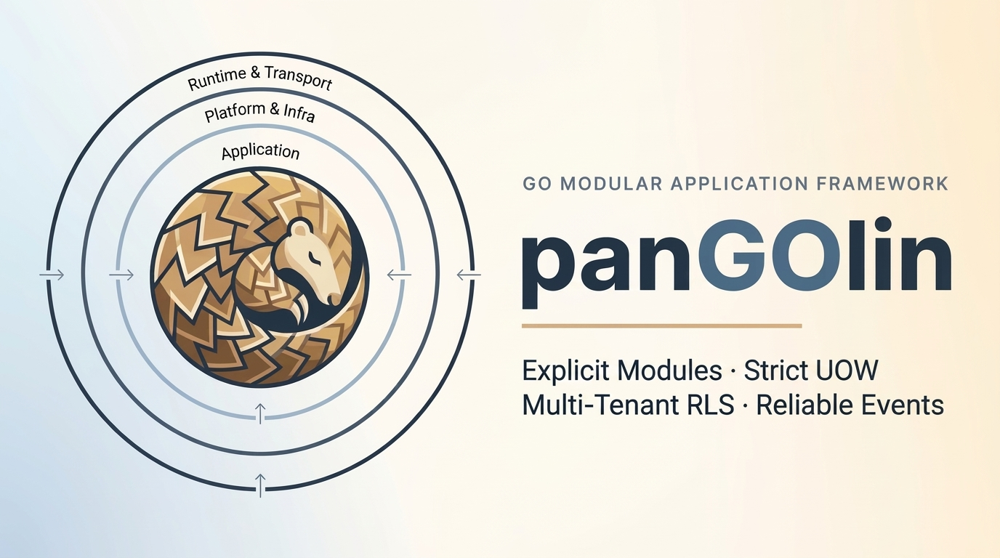

<p align="center"></p>

<h1 align="center">panGOlin Framework</h1>

<p align="center">
  <strong>顯式模組、嚴格交易、可靠事件，經得起高速演進的 Go 單體基座。</strong><br/>
  保留 Go 的顯式簡潔、拒絕隱式魔術。用不可繞過的 DI 可見性、工作單元、PostgreSQL RLS 與 Outbox/Inbox，讓人寫得順手、AI 也寫不歪。
</p>

<p align="center">
  
  <a href="docs/release-notes/0.1.0.md"></a>
  <a href="https://pangolin-framework.github.io/pangolin/"></a>
  <a href="LICENSE"></a>
</p>

---

**panGOlin** 是一個為中大型 Go 應用程式設計的模組化應用框架：先以**模組化單體（Modular Monolith）**高速交付，並透過公開 Application Port、受控 DI 可見性與版本化事件保留日後按領域拆分為獨立服務的能力。

> **目前版本**：`v0.1.0`（定義於 [VERSION](VERSION)）。完整使用手冊請見 [官方文件網站](https://pangolin-framework.github.io/pangolin/)，交付範圍與檢核紀錄見 [0.1.0 發布說明](docs/release-notes/0.1.0.md) 與 [驗收紀錄](docs/evidence/)。

## 核心設計特色

- **編譯期模組 DAG 與可見性 DI**：以 Go 型別參照宣告模組相依（`module.Of[T]()`），啟動前自動拓撲排序與封存容器；服務預設模組內私有，跨模組共享必須由契約擁有者顯式 `Export`。
- **顯式 Ambient Scope 與平行工作單元（UOW）**：基於 `kernel/ambient`（`ambient.Var[T]`）的不可變 Copy-on-Write 鏈傳遞操作情境（零 GLS、零全域變數），支援 `Required` 共根交易、多 goroutine 平行 `RequiresNew` 與 `uow.Detach`，並嚴格區分 `Committed`／`RolledBack`／`UOW_COMMIT_UNKNOWN`。
- **中立資料存取與多租戶隔離**：透過 `persistence/database` 支援 PostgreSQL、MySQL 與 SQLite；預設 fail-closed 安全管線整合可擴充登入（`security/identity`）、即時撤權租戶／資源 Scope、PostgreSQL `FORCE RLS` 與可選的 `modules/organization` 組織治理模組。
- **交易一致的可靠事件與即時通訊**：Local Event、有界 PostgreSQL Outbox／Inbox、租約 fencing、NATS JetStream、持久化背景工作（`platform/jobs`），以及可選的 SignalR 即時通訊模組（`modules/realtime`）。
- **精簡且型別安全的日常開發封裝**：內建泛型 HTTP 端點（`transport/http.CommandEndpoint`／`QueryEndpoint`）、宣告式 `application.Runner`、`postgres.CurrentWithScope`、`outbox.ForProducer(...).PublishJSON` 與流暢註冊器 `module.Register`。
- **開箱即用的 CLI 工具鏈（`cmd/pangolin`）**：支援 `new`（`tenant-only`／`organization`／`--realtime`）、`module add --preset service`、`migrate`、`doctor --live`、`generate openapi` 與安全三路比對的 `upgrade` 工作流。

---

## 快速開始

### 1. 本機快速體驗（無需啟動外部服務）

只需本機 Go 環境（`Go 1.27+`），不需要啟動 Docker、資料庫或 Message Broker，即可直接執行基礎範例與多模組契約示範：

```bash
# 基礎範例：第一個 Root 模組應用與優雅停機
cd examples/basics
go run ./hello
go run ./root-greeting

# 完整多模組介面契約示範（store / catalog / pricing / app）
cd ../moduleapp
MODULEAPP_DEADLINE=2s go run .
```

### 2. 用 `pangolin` CLI 建立獨立應用專案

安裝 `v0.1.0` 版本的 `pangolin` CLI，即可在任意工作目錄生成包含登入、PostgreSQL、RLS、遷移與 OpenAPI 的完整專案骨架：

```bash
# 安裝 pangolin CLI（請確認 $(go env GOPATH)/bin 已加入 PATH）
go install github.com/pangolin-framework/pangolin/cmd/pangolin@v0.1.0

# 建立新專案
pangolin new my-bookstore --template modular-monolith
```

加上 `--with organization` 可啟用完整企業／組織多層治理，加上 `--realtime` 可啟用 SignalR 即時通訊。若在倉庫內開發貢獻，亦可從根目錄執行 `go install ./cmd/pangolin`。

### 3. 瀏覽完整教學與 API 文件（Docusaurus）

完整版本化官方文件網站（含安裝指南、循序教學、CLI 子章節與雙平台指令）已發布於 GitHub Pages：

- **線上官方文件**：[https://pangolin-framework.github.io/pangolin/](https://pangolin-framework.github.io/pangolin/)

如需透過 Docker 在本機 `http://localhost:18088` 離線預覽：

```bash
node docs/site/scripts/docker.mjs up -d --build
```

更多網站操作與 GitHub Pages 設定見 [docs/site/README.md](docs/site/README.md)。

---

## 架構與核心套件

| 領域 | 核心套件 | 職責摘要 |
|---|---|---|
| **Kernel** | [ambient](kernel/ambient/README.md)、[module](kernel/module/README.md)、[di](kernel/di/README.md)、[config](kernel/config/README.md)、[runtime](kernel/runtime/README.md)、[app](kernel/app/README.md) | 顯式 Ambient Scope、模組 DAG、建構子 DI、分層組態與優雅停機 |
| **Application & Transport** | [application](application/README.md)、[transport/http](transport/http/README.md) | 宣告式 `Runner`、Command／Query 交易政策、泛型 HTTP 端點與 RFC 9457 錯誤映射 |
| **Persistence** | [uow](persistence/uow/README.md)、[database](persistence/database/README.md)、[postgres](persistence/postgres/README.md)、[mysql](persistence/mysql/README.md)、[sqlite](persistence/sqlite/README.md)、[migration](persistence/migration/README.md)、[idempotency](persistence/idempotency/README.md) | 工作單元、中立資料存取 Port、Goose 遷移與命令冪等對帳 |
| **Security & Tenancy** | [identity](security/identity/README.md)、[authn](security/authn/README.md)、[scope](security/scope/README.md)、[policy](security/policy/README.md)、[tenancy](tenancy/README.md)、[organization](modules/organization/README.md) | 可擴充認證管線、Tenant／資源 Scope 隔離、預設拒絕權限與可選組織治理 |
| **Events & Realtime** | [distributed](events/distributed/README.md)、[local](events/local/README.md)、[outbox](events/outbox/README.md)、[inbox](events/inbox/README.md)、[nats](events/nats/README.md)、[realtime](modules/realtime/README.md) | 版本化事件、同交易 Outbox／Inbox、NATS JetStream 與可選 SignalR 即時推播 |
| **Platform & Observability** | [audit](platform/audit/README.md)、[settings](platform/settings/README.md)、[features](platform/features/README.md)、[cache](platform/cache/README.md)、[jobs](platform/jobs/README.md)、[observability](observability/README.md) | 同交易稽核、5–7 層設定、受權限約束的 Features、Scoped Cache、持久化 Jobs 與 OpenTelemetry |
| **CLI & Examples** | [cmd/pangolin](cmd/pangolin/README.md)、[examples/basics](examples/basics/README.md)、[examples/moduleapp](examples/moduleapp/README.md)、[examples/bookstore](examples/bookstore/README.md) | 專案腳手架、獨立學習範例與完整 API＋Worker 實戰示範 |

---

## 開發、測試與工程文件

```bash
# 快速靜態與契約檢查（架構 import 邊界、需求與 API 清單）
go run ./tools/check
python scripts/contracts.py check
python scripts/template_bundle.py --check

# 執行無外部服務的單元與契約測試
go test ./kernel/... ./application/... ./transport/... ./persistence/... ./security/... ./tenancy/... ./events/... ./platform/... ./observability/... ./modules/... ./tests/rootmodules/...
```

完整整合測試（需隔離 Docker PostgreSQL／NATS／Test IdP）與專案維護入口：

- **目錄與程式歸屬**：[docs/guides/repository-layout.md](docs/guides/repository-layout.md)
- **架構總覽與正式規範**：[完整架構與實作規劃書](design/panGOlin-framework_完整架構與實作規劃書.md) · [實作規範書](design/panGOlin-framework_實作規範書.md) · [里程碑規劃書](design/panGOlin-framework_里程碑規劃書.md)
- **測試、工具與架構決策**：[測試索引](tests/README.md) · [工具索引](tools/README.md) · [ADR 紀錄](docs/adr/README.md) · [歷史里程碑驗收紀錄](docs/evidence/)

---

## 設計靈感與致謝（Acknowledgments）

panGOlin Framework 是一套獨立維護的 Go 模組化應用框架。在模組化單體架構分層、工作單元（Unit of Work）、多租戶與資源 Scope 隔離、分層設定與功能旗標，以及文件導覽組織等設計上，借鑑了 [ABP Framework](https://abp.io/) 等開源企業級框架的設計理念，謹此致謝。

## 授權條款（License）

本專案採用 **Apache License, Version 2.0** 授權，完整條文與歸屬聲明見 [LICENSE](LICENSE) 與 [NOTICE](NOTICE)。透過 `pangolin` CLI 生成的使用者專案業務程式碼歸使用者自行選擇授權，內附的 `framework/` Runtime 目錄則保留框架本身的 `LICENSE` 與 `NOTICE`。
