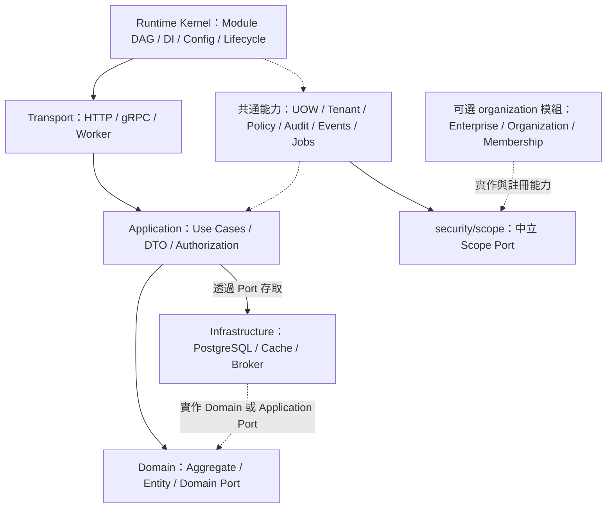
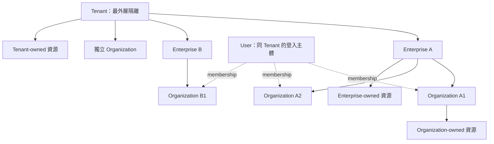

# panGOlin-framework｜完整架構與實作規劃書

> **文件基線：** v1.3；承接整合稿 v1.2，產品目標 v0.1。  
> **狀態：** 已成文、待實作與證據驗收；文件檢查不代表功能已完成。

## 0. 文件入口與權威

本檔保留原檔名，作為 panGOlin-framework 的架構總覽。v1.3 已將整合稿 v1.2 的契約、驗收與排程分離；原章節中的詳細內容搬到下列文件，不再維護第二份需求或時間表。

| 文件 | 內容與唯一權威 | 讀者用途 |
|---|---|---|
| [實作規範書](panGOlin-framework_實作規範書.md) | 95 項正式需求、Go 契約、失敗語意、資料安全、A01–A95、品質與版本範圍 | 實作、測試、替換 Adapter、符合性審查 |
| [里程碑規劃書](panGOlin-framework_里程碑規劃書.md) | M0–M6、工作包、相依、漸進驗證、逐項交付映射、發布證據 | 排程、分工、進度與交付判定 |
| 本文件 | 系統定位、架構圖、設計理由與閱讀索引 | 快速理解設計與找到權威章節 |

需求與驗收目前是待實作基線；文件檢查或範例片段編譯不表示 production code 已存在。產品版本範圍以實作規範 §15 為準；工期以里程碑規劃書為準。規範變更先更新唯一正式定義，再同步案例、交付映射與本總覽。

## 1. 系統定位與分層

panGOlin-framework 是 Go 模組化應用框架，先提供模組化單體，透過公開 Application Port 與事件契約保留後續拆服務能力。業務 Domain 不依賴 Runtime、資料庫或 HTTP；Infrastructure 實作業務所需的 Port，Runtime 負責組裝。

依賴方向、package 邊界與啟動順序見[實作規範 §1–§2](panGOlin-framework_實作規範書.md#s-1)。圖中的呼叫／能力關係不代表允許 Application import 具體 Adapter。

## 2. 交易與可靠事件的設計理由

UOW 表示業務操作與資源生命週期；DB Transaction 是其使用的持久化機制。Required 共用根責任，RequiresNew 取得獨立交易且可能先於父操作提交，因此不能假裝成 Savepoint。Commit Unknown 與確定回滾是不同結果；HTTP 回應遺失也不抹除已提交狀態。

Local Event 用來維持同程序、同交易的規則；Outbox 與業務一起持久化，Inbox 在消費端保護本地效果，外部副作用仍需要冪等。此設計選擇可驗證的 at-least-once，不承諾跨資料庫原子性或端到端 exactly-once。

完整契約見[UOW §5](panGOlin-framework_實作規範書.md#s-5)、[事件 §6](panGOlin-framework_實作規範書.md#s-6)、[冪等 §14.2](panGOlin-framework_實作規範書.md#s-14.2)。實作所需的選項、取消／Panic 清理、回呼、重試與提交結果已在專用規範確立。

## 3. Tenant、Enterprise 與 Organization

Tenant 保持最外層安全邊界。Enterprise 管理多個 Organization；Organization 可獨立，或隸屬同 Tenant 的一個 Enterprise。User 可加入多個 Organization，各自角色獨立。Enterprise 管理身分與 Organization 內容授權分開，精確 owner 隔離使父層不自動取得子層業務資料。

Enterprise／Organization／Membership／治理都在單一 `modules/organization` 模組。核心只依賴中立 Scope Port，因此新專案可用 tenant-only；使用組織的專案可在部署時替換實作，前提是保留公開契約與既有 owner 身分。既有非 Tenant 資料不能靠刪除 Provider 無聲變成 Tenant 共用。

此選擇避免兩種耦合：業務表直接綁死預設組織私有 schema，以及 UOW／Repository 認識具體組織模型。中立 Scope Catalog 與公開管理 Port 承接相容性。詳細關係、撤權快照、RLS、事件傳播、遷移及停用契約見[實作規範 §7.6–§7.12](panGOlin-framework_實作規範書.md#s-7.6)。

## 4. 核心取捨與風險

| 選擇 | 原因 | 代價／控制 |
|---|---|---|
| 先單一 PostgreSQL 與 Broker Adapter | 先證明資料與配送語意 | 其他 Provider 需獨立契約證據 |
| 明確 constructor／Port／context | 讓相依及交易邊界可追蹤 | 需要固定公開 API 與組裝檢查 |
| owner 精確隔離 | 防止同 Tenant 不同組織資料混用 | 跨組織彙總另建授權 Read Model |
| 單一可選 Organization 模組 | 不讓所有專案背負組織模型 | profile、替換與遷移增加測試成本 |
| 必要 Audit 與業務同交易 | 避免成功操作沒有稽核 | 稽核寫入失敗會阻止提交 |
| 真實 DB／Broker 故障驗證 | 不讓 Mock 掩蓋提交與重送差異 | CI 需要故障裝置及可重現環境 |
| 文件契約與排程分開 | 避免範例、Roadmap、驗收互相覆寫 | 變更時檢查 ID、案例與單一交付映射 |

原 24 週估算在新增 Organization／Scope 後需要重估；詳細責任、風險及關鍵路徑見[里程碑規劃書](panGOlin-framework_里程碑規劃書.md)。完整範圍與排程由各自權威文件維護，此處不再列第二份版本清單。

## 5. 舊章節到新文件的導覽

| 整合稿 v1.2 舊章節 | v1.3 位置 |
|---|---|
| §0 執行摘要／範圍／權威 | 本總覽與實作規範 §0 |
| §1–§10 架構、UOW、事件、安全、資料、平台、目錄 | 實作規範 §1–§10 |
| §11 選型／ADR | 實作規範 §11；ADR 責任見里程碑規劃 §2 |
| §12 CLI／指南 | 實作規範 §12 |
| §13 Roadmap／交付映射 | 里程碑規劃 §3–§6 |
| §14 測試／品質 | 實作規範 §13 |
| §15 安全／冪等／運維 | 實作規範 §14 |
| §16 風險 | 本總覽 §4；里程碑規劃 §7 |
| §17 版本／未決環境值 | 實作規範 §15／§11.2 |
| §18 Definition of Done | 里程碑規劃 §8 |
| §19 跨子系統正式需求 | 實作規範 §16 |
| 附錄 A–C | 實作規範附錄 A–C |

需求 ID 及 A01–A95 未因拆分重編。規範可獨立供實作使用，規劃文件可獨立供分工與追蹤使用；兩者以 ID 連接。
