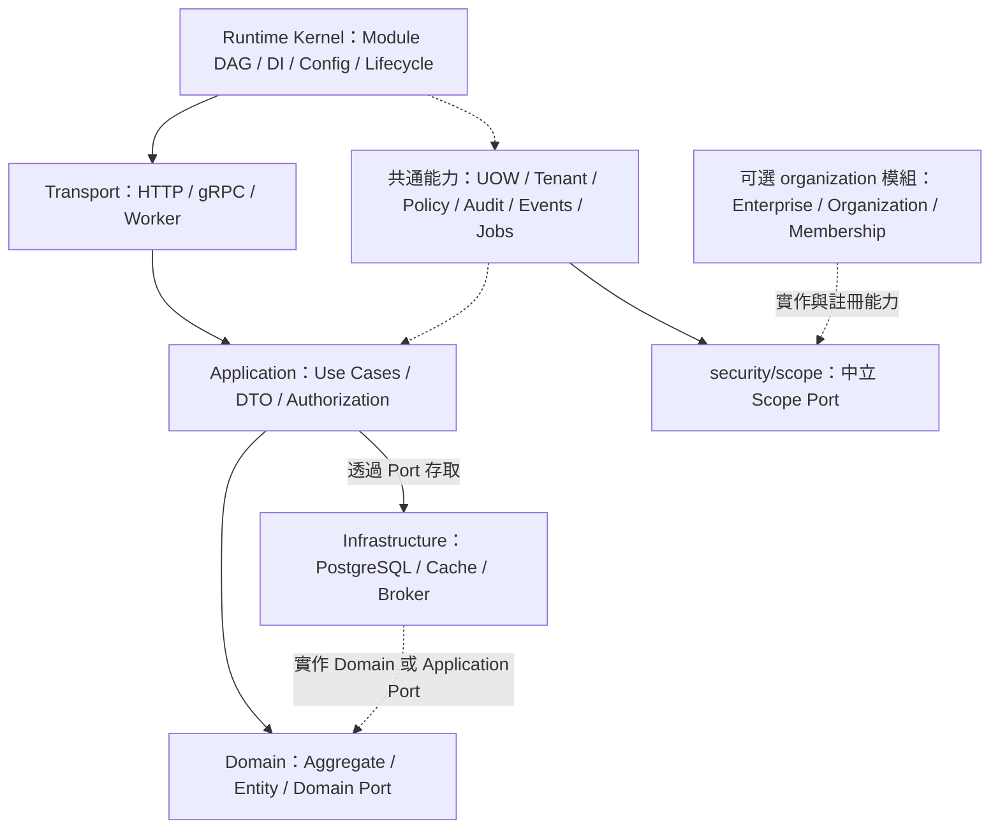
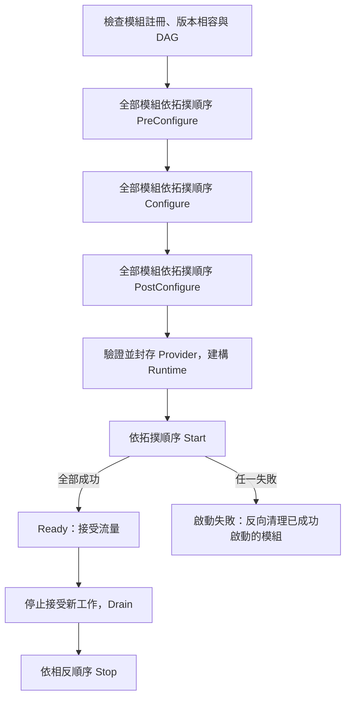
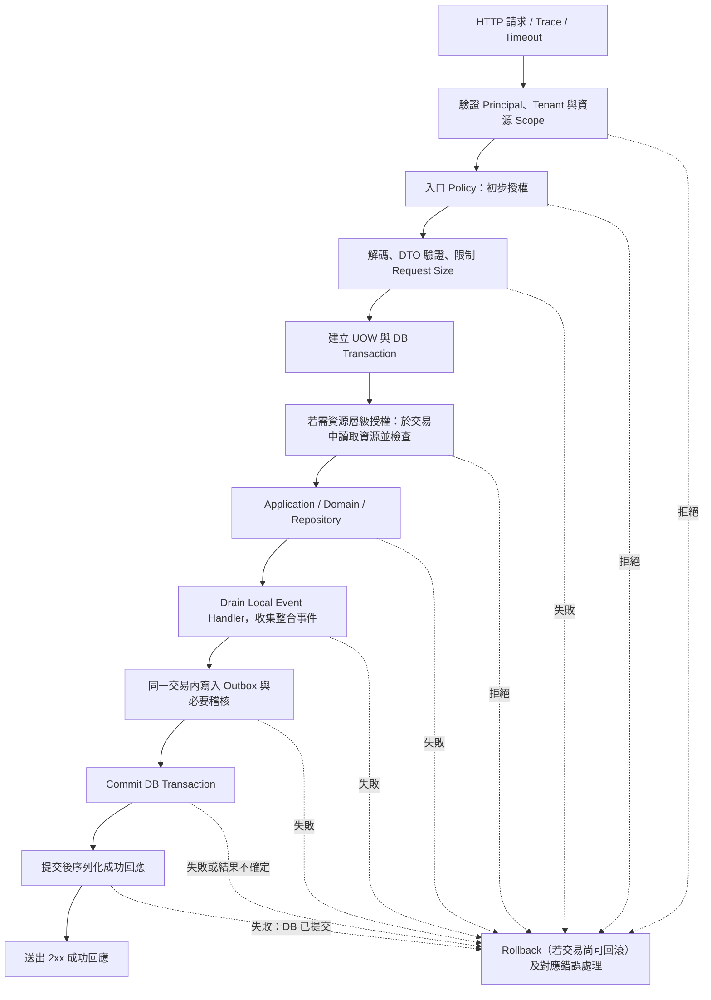
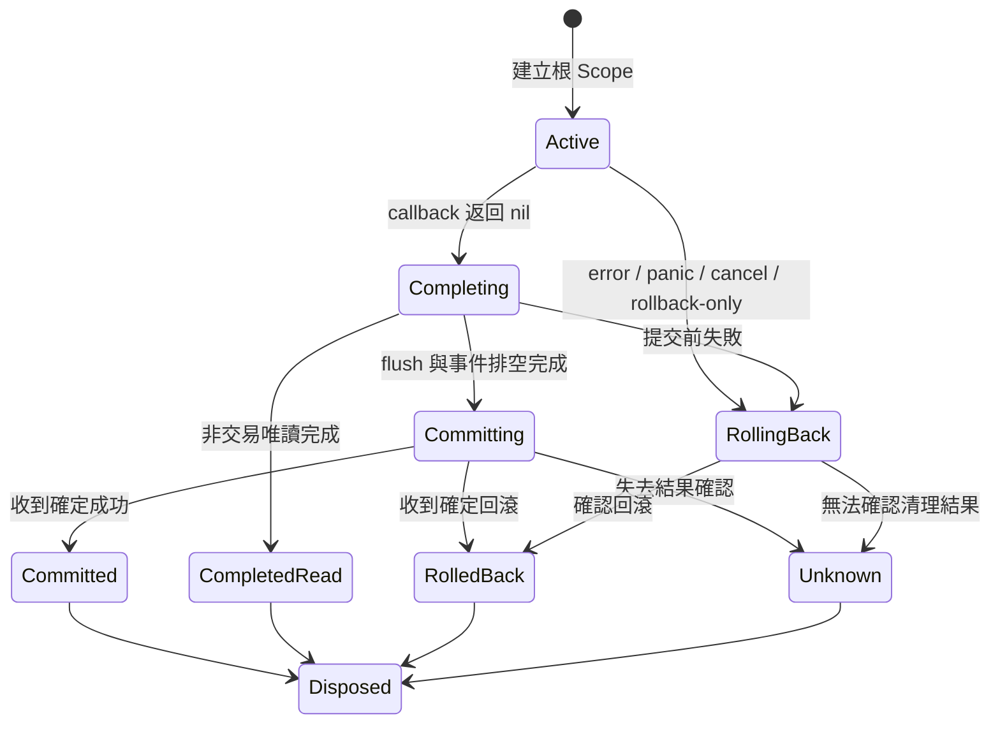
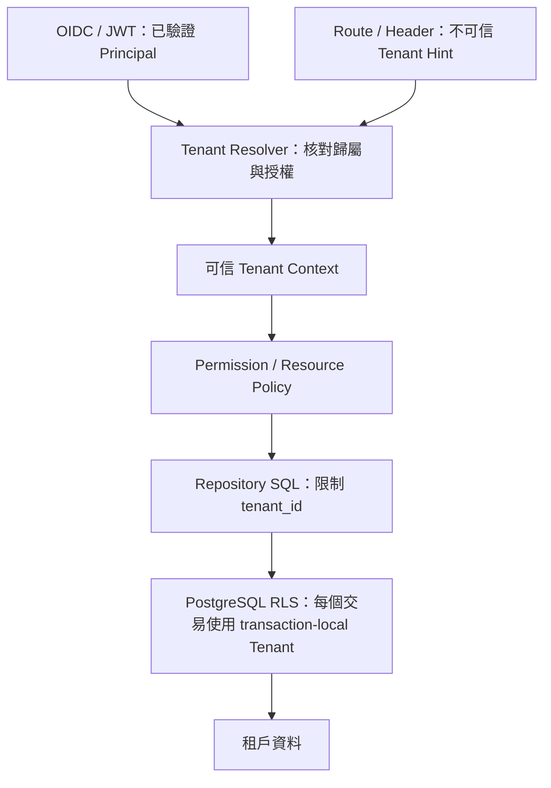
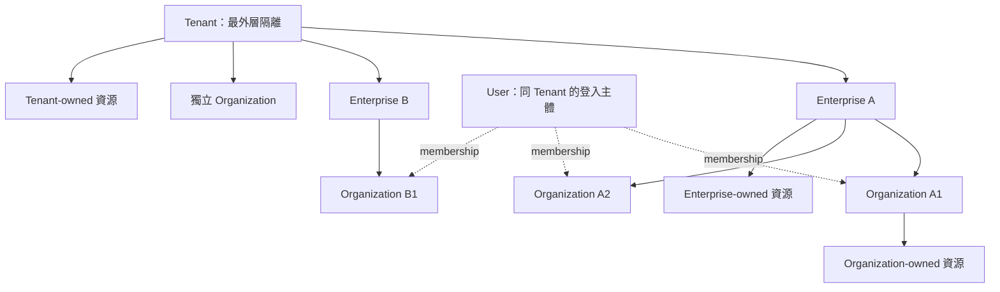

# panGOlin-framework｜完整架構與實作規劃書

> **文件狀態：** 架構與契約修訂基線 v1.2（產品目標 v0.1；待實作證據驗收）。  
> **適用對象：** 架構師、Go 後端工程師、技術主管、QA、SRE、安全審查人員。  
> **目的：** 以本文件直接建立工作項目、實作介面、開發測試、進行設計審查與版本驗收。  
> **用語與權威：** 見 §0.4；文件修訂版號與產品發布版號分開管理。  
> **產品名稱：** `panGOlin-framework`；CLI 建議命名 `pangolin`；Go module path 於正式 Git 倉庫確定後凍結。

## 0. 執行摘要

panGOlin-framework 是以 Go 建構的**模組化應用程式框架**，定位為「先支援模組化單體，保留逐步拆分服務的能力」。它提供一致的模組生命週期、依賴組裝、分層應用服務、交易範圍、租戶隔離、可選的 Enterprise／Organization 資源隔離、權限策略、事件可靠配送、背景工作及可觀測性，使業務模組可在統一規範下開發、部署與測試。

**首個端到端成果：** S3／W6 運行最薄的 Bookstore 流程：HTTP → 身分與租戶檢查 → 權限與資料驗證 → Application Service → Domain → Repository → UOW → PostgreSQL Commit → Outbox → Worker → Consumer，證明基本成功、回滾、重送與租戶拒絕。完整 UOW／安全／可靠性矩陣在後續切片逐步補齊，依 §13、§14 的正式交付 gates 驗收，不把首次跑通當成所有保證已完成。

**架構底線：**

1. 明確的依賴方向：業務層只依賴 Port；基礎設施實作 Port。
2. 一個業務案例對應一個可理解、可測試的交易邊界；UOW 與資料庫交易是兩個不同概念。
3. 對非串流寫入 API，交易 Commit 成功後，才允許送出 2xx 成功回應；Commit 後的序列化／網路失敗不代表業務交易已回滾。
4. Local Event 與 Distributed Event 不混用；Outbox/Inbox 是可啟用的可靠性機制，不假定所有事件都經過 Broker。
5. Tenant 始終為最外層隔離；可選的單一 organization 模組提供 Enterprise／Organization 管理與資源隔離，並由身分授權、Scope-aware Repository 及資料庫安全控制共同保護。
6. Go 優先使用建構函式注入、介面、`context.Context` 與明確的錯誤處理；不引入隱含攔截器魔法。
7. 僅提供能被測試證明的交付保證，不宣稱跨資料庫原子性或端到端 Exactly-once。

### 0.1 專案範圍與不在範圍

| 分類 | 明確範圍 |
|---|---|
| **主要目標** | 模組化單體核心、DDD Friendly、UOW、租戶／權限安全、事件可靠性、開發工具與可觀測性 |
| **次要目標** | 在維持模組邊界下，支援未來服務拆分與多 Adapter |
| **第一版非目標** | 自建完整身分供應商、分散式交易、所有資料庫／Broker 通吃、視覺化 IDE、動態熱插拔、不受限的反射式 DI |
| **交付型態** | 公開的 Go packages、範例程式、遷移腳本、CLI、設計文件、測試套件 |
| **預期使用者** | SaaS API、企業後台、業務中台、具多租戶需求的 Go 團隊 |

### 0.2 驗收等級

- **Kernel 完整：** 模組載入、Container、Config、生命週期、錯誤處理。
- **應用完整：** Use Case、DDD 基元、UOW、Repository、驗證、授權。
- **平台完整：** Tenant、Audit、Events、Outbox/Inbox、Background Jobs、Settings/Features；organization-enabled profile 另含完整 Enterprise／Organization 模組。
- **工程完整：** 範本、遷移、文件、CI、效能、安全及操作手冊。

### 0.3 文件性質與校對界線

本文件同時容納架構說明、產品契約與交付計畫。這是待實作及驗收的規格，不是已上線行為保證。Go 片段為契約與呼叫示例；SQL 及失敗語意由指定版本的真實 PostgreSQL／Broker 測試驗證。靜態文件檢查或 Go 語法解析通過，不代表完整程式已通過型別檢查、執行測試或達到覆蓋率門檻。

### 0.4 規範用語、權威與符合性類別

`MUST`、`MUST NOT`、`SHOULD`、`SHOULD NOT`、`MAY` 按 RFC 2119／RFC 8174 解讀；`MAY` 表示契約允許的選項，不等於未來版本承諾。

| 內容 | 唯一權威與使用方式 |
|---|---|
| 產品行為 | §5.7 的 UOW 需求與 §19 的跨子系統需求；每個穩定 ID 只定義一次 |
| 契約參數 | 需求明確引用的介面、選項表、錯誤表與流程細則是該需求的一部分；實作者以同一 ID 回報證據 |
| 架構說明／範例／附錄 | 說明上述契約，不能增加、覆寫或放寬保證；示例不是另一份規格 |
| 驗證 | §14 定義 setup、刺激、可觀察結果與證據；測試不創造新的產品義務 |
| 排程與版本 | §13.3 唯一指定每項需求的交付里程碑；§17 唯一定義 v0.1 必交與延期範圍 |

符合性類別：**Core Runtime**（模組／DI／UOW／中立 Scope）、**PostgreSQL Adapter**（交易／Repository／RLS）、**Reliable Event Adapter**（Outbox／Inbox／Broker）、**Application／Transport Adapter**（入口與安全）、**Distribution／CI**（CLI、版本與品質門檻），以及可選的 **Organization Module**（Enterprise／Organization 同一模組）。框架 v0.1 發布包交付並驗證所有類別；應用可選 tenant-only 而不安裝 Organization Module，或選 organization-enabled 並通過其適用契約。單一類別通過不能宣稱所有 Profile 都符合。

後續變更先修改需求 ID 及其參數，再同步案例與排程；已發布 ID 不因章節移動而重編。若說明或圖表與需求不一致，該矛盾列為文件缺陷並阻擋凍結，不讓實作者自行選擇較寬鬆的版本。實作者可直接依本文件完成 UOW，不需要參照其他框架原始碼。

## 1. 系統總體架構

**圖 1｜整體模組與分層關係（內嵌 Mermaid，不依賴外部圖片）**




### 1.1 分層設計與依賴方向

| 層級 | 責任 | 可依賴 | 不得依賴 |
|---|---|---|---|
| Transport | HTTP/gRPC/Worker 入口、路由、編解碼、請求驗證及錯誤映射 | Application、Kernel contracts | SQL 實作、業務資料庫表格 |
| Application | Use Case 編排、交易政策、授權、DTO、呼叫 Domain Port | Domain、共用 Port | 具體資料庫／Broker／HTTP 框架 |
| Domain | Entity、Value Object、Aggregate、Domain Service、領域事件及不變條件 | 標準函式庫與極薄共用基元 | HTTP、ORM、外部服務、框架 Runtime |
| Infrastructure | Repository 實作、訊息 Adapter、快取、身分供應者 | Domain Port、Application Port | 反向讓 Domain 引用具體 Adapter |
| Runtime / Platform | Module、DI、Config、UOW、Tenant、Policy、Telemetry 等共通機制 | 抽象介面與已註冊 Provider | 業務模組特有模型 |

**主要規則：** 一個模組可以分成 `domain`、`application`、`infrastructure` 與 `transport` 子套件；Application 的 Repository Port 可以宣告在該業務模組的 Domain/Application 中，而由 PostgreSQL Adapter 實作。業務 Domain 不必知道模組 Registry 或 HTTP Pipeline。

### 1.2 核心套件與模組責任

| 套件／模組 | 對外提供 | 重要不變條件 | 交付優先級 |
|---|---|---|---|
| `kernel/module` | Module 定義、依賴解析、分階段生命週期 | 依賴循環／缺漏必須阻止啟動 | P0 |
| `kernel/di` | Provider 註冊與解析、生命週期 | 註冊完成後不可變；禁止隱式覆寫 | P0 |
| `kernel/config` | 組態載入、驗證及覆寫規則 | 必填組態錯誤須啟動失敗 | P0 |
| `kernel/runtime` | Bootstrap、Start、Ready、Shutdown | 停機不接新流量並反向釋放 | P0 |
| `application` | Use Case 與 Command/Query 契約 | 不得呼叫具體 Adapter | P0 |
| `domain` | Entity、Aggregate、Domain Event 基元 | 業務不變條件由 Domain 保證 | P0 |
| `persistence/uow` | 交易協調、回滾、事件收集 | 同 UOW 共享同一根 Scope 內的交易資源共用；RequiresNew 獨立 | P0 |
| `persistence/postgres` | SQL、Repository、遷移 | 所有租戶資料查詢必受隔離 | P0 |
| `security` | Authentication、Policy、Permission | 預設拒絕，無授權不放行 | P0 |
| `tenancy` | Tenant Resolver、Context、資料隔離 | Tenant 不得由單一 Header 決定 | P1 |
| `security/scope` | ScopeRef、Resolver／Provider Port、TenantScopeProvider | Core 不依賴具體組織模型；無授權不得降級至 Tenant | P1 |
| `modules/organization`（選用） | Enterprise、Organization、Membership、治理 Port／Provider | 同一獨立模組、User 多組織、所有 Scope 仍在單一 Tenant 內 | P1 |
| `events/local` | UOW 內本機事件佇列 | 提交前 Handler 失敗可阻斷交易 | P1 |
| `events/distributed` | Event 契約及 Broker Port | 遠端事件不具跨系統原子性 | P1 |
| `events/outbox` | Outbox 寫入與 Worker | 未 Commit 的事件不得配送 | P1 |
| `events/inbox` | Inbox 去重與消費 Worker | 同一 consumer group 重複事件不重做副作用 | P1 |
| `platform/jobs` | 背景任務、重試與租約 | 重複派發需可安全處理 | P1 |
| `platform/audit` | 操作稽核與資料異動事件 | 敏感資訊遮罩與保留政策 | P1 |
| `platform/settings` | 分層設定提供者 | 優先序確定且具快取失效策略 | P2 |
| `platform/features` | 功能開關與租戶能力 | 不取代後端授權 | P2 |
| `cmd/pangolin` | `new`、`module`、`migrate`、`doctor` | 產出可編譯、可測試工程 | P2 |

### 1.3 部署模型

首版以**單一 API 程序 + 一個或多個 Worker 程序 + PostgreSQL + 可選 Redis/Broker**運行。模組是編譯期註冊的程式碼組織與部署單位，不是動態下載的 DLL/Plugin。跨服務拆分時，保留 Application Port 與事件契約，改由 Adapter／網路邊界實作，不把整個 Runtime 強迫複製到每個微服務。

## 2. 模組系統與生命週期

**圖 2｜模組生命週期與失敗處理**




### 2.1 模組描述與依賴圖

每個模組必須宣告唯一 `Name`、版本資訊、相依模組、Provider 註冊與生命週期回呼；相依項的名稱與版本範圍須以 `Dependency` 契約表達，而非只靠名稱字串。主程式以編譯期明確加入模組。Runtime 執行以下步驟：

1. 蒐集模組清單，拒絕重複名稱、缺漏相依與不相容版本。
2. 建立 Directed Acyclic Graph（DAG），採穩定拓撲排序（同一層依名稱排序，確保可重現）。
3. **跨全部模組分階段**呼叫 `PreConfigure`、`Configure`、`PostConfigure`；不是一個模組跑完三階段才輪到下一個。
4. 驗證 Provider 是否重複、缺漏或循環，封存註冊表、建構 Runtime。
5. 按拓撲順序 `Start`，全部成功才對外報告 Ready；失敗時反向回收已成功啟動的模組。
6. 停機時先停止接收流量，等待正在執行的工作，再依相反順序 `Stop`；超時後保留錯誤並結束。

### 2.2 建議 Go 契約

```go
type Dependency struct {
    Name              string
    VersionConstraint string // 由 M0 選定的版本範圍語法解析與驗證
}

type Module struct {
    Name       string
    Version    string
    DependsOn  []Dependency
    RequiredScopeKinds []string // capability；缺 Provider 時不 Ready

    PreConfigure  func(*Builder) error
    Configure     func(*Builder) error
    PostConfigure func(*Builder) error

    Start func(context.Context, *Runtime) error
    Stop  func(context.Context, *Runtime) error
}

type Registry interface {
    Register(Module) error
    Plan() (Plan, error) // topo-order 與缺漏/循環資訊
}
```

`Builder` 僅可供註冊與組態操作，不可在 `Configure` 時解析尚未建立的 Runtime Service；所有 `Start` 回呼應可辨識失敗並回收資源，禁止默默吞掉錯誤。**熱重載模組不在首版範圍**。

### 2.3 DI 與 Provider 作用域

- **Singleton：** 無狀態或可安全共用的 Adapter；初始化後不可變。
- **Transient：** 透過 Factory 建立的物件；不得被 Singleton 長期保留不安全的請求狀態。
- **Request/Operation Scope：** `context.Context` 傳遞 Principal、Tenant、Trace、UOW 等操作範圍資料；不模擬執行緒區域變數。
- Provider Registry 依 §19 規定 在啟動前完成相依圖的靜態驗證；需 Request Scope 的物件則在 Scope 中實際建構及釋放；相同鍵重複註冊預設錯誤，覆寫需使用明確 API 與記錄原因。
- Factory 依 §19 規定 遵循錯誤傳回與清理契約；不得在 Provider 建構期間觸發服務呼叫造成隱性循環。

### 2.4 組態分層與檢核

預設優先序：`編譯期預設 < config file < environment < CLI flags`；Secrets 由環境或密鑰管理服務注入，不能寫入可提交至 Git 的檔案。啟動時驗證：Port 範圍、PostgreSQL DSN、JWT Issuer/Audience、Broker 選擇、租戶模式、Outbox 開關及 Worker 容量。支援以不同 Config Profile 建立測試 Runtime，但不允許在請求途中改寫已封存的啟動設定。

## 3. 請求管線與應用服務

**圖 3｜非串流 HTTP 寫入請求：交易成功後才送出 2xx**



註：Commit 回傳錯誤時，交易結果可能不確定。回應序列化若在 Commit 後失敗，業務資料仍已提交。兩種情況均須提供操作查詢與冪等重試機制，不應假設資料一定已回滾。

### 3.1 標準非串流請求流程

這是 **panGOlin-framework 明定的處理政策**，所有內建 HTTP Adapter 均遵守：

1. 建立 Request ID、Trace Span、Timeout；Recover 捕獲 Panic 並產出標準錯誤。
2. 驗證 OIDC/JWT 或 Session，得到可信 Principal。
3. 解析路由與 Header 提供的 Tenant Hint，和 Principal 的租戶歸屬核對後產出 `TenantContext`；再依 §7.6–§7.10 解析並授權資源 Scope Hint，綁定可信 ScopeRef。純 Tenant 路由選 tenant scope，組織路由要求明示 scope。
4. 評估不需載入資源的入口 Policy 與 Permission；未授權時拒絕。
5. 解碼 DTO、檢查大小限制及驗證格式；未通過不進入業務交易。
6. 以 UOW Policy 進入 Use Case；若需依資源狀態授權，在同一操作範圍中讀取資源並做 Resource Policy 檢查，以降低檢查與修改之間的競態。
7. Repository、提交前 Local Handler、資料儲存、Integration Event Outbox 及必要稽核共用 DB Transaction；若其中任一步驟失敗，應 Rollback。
8. Commit 成功後才序列化並傳送非串流 JSON 寫入 API 的 2xx。若序列化或傳輸在 Commit 後失敗，業務可能已成功但客戶端只收到錯誤／連線中斷；框架必須記錄操作識別碼，並提供冪等鍵或操作狀態查詢。若 Commit 結果不確定，回覆不得暗示可無條件安全重試。
9. Trace、Metrics 及非關鍵操作性稽核可在提交後發送；必要稽核在交易內持久化，不得因後續非關鍵 Telemetry 故障將已成功的交易回覆為業務失敗。

**注意：** 伺服器在 Commit 後送出成功回應時，網路中斷仍可能造成「資料已提交、用戶端沒收到結果」。因此對可重試寫入 API 必須使用 Idempotency-Key 或操作狀態查詢。

**例外：** Streaming／SSE／WebSocket 的回應可能先於工作完成，因此不得讓同一個資料庫交易涵蓋串流生命週期。使用獨立短交易、明確確認訊息或狀態輪詢，對外文件不得宣稱「串流完成等同交易提交」。

### 3.2 Command 與 Query Policy

| 類型 | 預設 UOW | DB Transaction | HTTP 回應政策 |
|---|---|---|---|
| Command（POST/PUT/PATCH/DELETE） | Required | PostgreSQL Transaction（ReadWrite） | Commit 後送 2xx |
| Query（GET） | Read Scope | 單租戶可非交易；共享資料庫若啟用 RLS 則使用唯讀交易 | 回傳讀取結果；不得偷偷變更資料 |
| Background Job | Explicit | 由 Job/Use Case Policy 決定 | Job 狀態與業務交易分開 |
| Event Consumer | Explicit | 有本機狀態與 Inbox 時使用 Transaction | Broker ACK 以持久化結果為準 |
| Streaming | Per-operation | 不保留長時間交易 | 使用操作確認機制 |

### 3.3 標準錯誤契約

API 使用 `application/problem+json`（RFC 9457 風格），包含 `type`、`title`、`status`、`detail`（經安全過濾）、`instance`、`traceId`、`code`。業務錯誤標準化：`MALFORMED_REQUEST=400、VALIDATION_FAILED=422`、`UNAUTHENTICATED=401`、`PERMISSION_DENIED=403`、`NOT_FOUND=404`、`CONFLICT=409`、`RATE_LIMITED=429`、`DEPENDENCY_UNAVAILABLE=503`、`INTERNAL=500`。公開訊息不可洩露租戶存在性、SQL 或堆疊資訊。

## 4. DDD 業務模型與模組邊界

### 4.1 核心模型

- **Entity：** 具有穩定識別碼與版本欄位，生命週期內 ID 不變。
- **Value Object：** 無識別碼，以不可變值定義等同性，建構時檢查規則。
- **Aggregate Root：** 對外一致性邊界；Repository 以 Aggregate Root 為主要儲存單位。
- **Domain Service：** 跨 Aggregate、不屬於單一 Entity 的領域決策。
- **Domain Event：** 描述已發生的領域事實，事件內容是純資料，不攜帶 DB Handle 或 Request 物件。
- **Application Service：** 編排 Use Case、授權與交易，不搬運業務不變條件至 Controller。
- **Repository Port：** 僅暴露業務需要的查詢/儲存操作；不硬推萬用 CRUD。

### 4.2 Domain 事件政策

Aggregate 可保留尚未派送的事件（或由 Use Case 明確追加）；Repository/UnitOfWork 在提交前收集，按照已註冊 Handler 依序處理。Handler 若需更新資料，須取得相同 UOW；不得跨服務同步遠端呼叫來保證原子性。Domain Event 不直接等於對外整合事件；對外 Event 必須使用版本化契約與允許公開的欄位。

### 4.3 跨模組互動

允許的整合方式：直接呼叫公開 Application Port（同程序同步）、本機 Domain/Application Event（同程序流程）、版本化 Distributed Integration Event（跨服務非同步）。禁止其他模組直接操作對方的資料表、依賴私有 Go package、或持有對方 Aggregate 的具體實作。跨模組共享查詢優先使用 Query Port 或專用 Read Model。

## 5. Unit of Work 嚴格契約

### 5.1 Scope、根邊界與交易

UOW 是操作範圍，持有有效選項、已驗證 Tenant／Principal／ScopeRef、資源識別、事件佇列與完成回呼；DB Transaction 是其中可選的資料庫資源。根 Scope 是一次 `Within` 真正建立的範圍，加入它的 `Required` 不是第二個可提交的交易。`RequiresNew` 則建立另一個根 Scope；父子根 Scope 之間不具原子性。

`context.Context` 傳遞目前 Scope，沒有全域 Current、goroutine-local、動態代理或反射攔截器。`Current(ctx)` 僅提供當下範圍的受控介面；Repository 接收 callback 給的 context，不能捕捉舊 context 逃出生命週期。範圍中的 Items 如需擴充，以 package 私有型別鍵實作，不能替換 Tenant、Principal、ScopeRef、Executor 或交易選項。

Required 的子 context 是加入根 Scope 的受限視圖；子 callback 結束即失效，但不關閉根資源。`Current` 對無 Scope、已結束或暫停的視圖返回 false；資料存取仍回傳對應生命週期錯誤，不因 Current=false 就自動另開交易。子視圖的 ID 指向共享根 Scope，Options 則保留該子視圖的唯讀／deadline 限制。

第一版提供可寫交易、唯讀交易、非交易唯讀範圍、`Required`、`RequiresNew`。**不提供非交易業務寫入、Savepoint、Suppress、跨資料庫原子提交或隱式重試。**這些情境的結果是明確拒絕，不是默默降級。純健康檢查可不建立 UOW；它不取得業務 Repository 權限。業務 Repository 在沒有有效 Scope 時連讀取也拒絕，由 Application 入口建立 ReadOnly Scope；明示的健康檢查與佇列候選枚舉使用專用 Infrastructure Port。

### 5.2 Go 介面、選項解析與預設值

```go
type AccessMode uint8
const (
    AccessDefault AccessMode = iota
    ReadOnly
    ReadWrite
)

type TransactionMode uint8
const (
    TransactionAuto TransactionMode = iota
    Transactional
    NonTransactional
)

type Propagation uint8
const (
    Required Propagation = iota
    RequiresNew
)

type Isolation uint8
const (
    IsolationDefault Isolation = iota
    ReadCommitted
    RepeatableRead
    Serializable
)

type Options struct {
    Mode        AccessMode
    Transaction TransactionMode
    Propagation Propagation
    Isolation   Isolation
    Timeout     time.Duration
}

type DefaultOptions struct {
    DefaultTimeout      time.Duration
    CleanupTimeout      time.Duration
    HookTimeout         time.Duration
    MaxRequiresNewDepth int
}

type EffectiveOptions struct {
    Mode          AccessMode
    Transactional bool
    Isolation     Isolation
    Deadline      time.Time
    DatabaseKey   string
    ResourceScopeKind string // 從可信 binding 複製；不是 Options 可覆寫欄位
    ResourceScopeID   string
}

type Outcome uint8
const (
    NotStarted Outcome = iota
    Committed
    CompletedNonTransactional
    RolledBack
    Unknown
)

type Completion struct {
    ScopeID     string
    OperationID string
    Outcome     Outcome
    Err         error
}

type Scope interface {
    ID() string
    Options() EffectiveOptions
    SaveChanges(context.Context) error
    SetRollbackOnly(cause error) error
    OnCompleted(func(context.Context, Completion) error) error
    OnFailed(func(context.Context, Completion) error) error
    OnDisposed(func(context.Context, Completion) error) error
}

type UnitOfWorkManager interface {
    Within(context.Context, Options, func(context.Context) error) error
    Current(context.Context) (Scope, bool)
}
```

介面型別屬 `uow` package，呼叫示例可省略 package 前綴。Domain 不依賴 Manager；Application 的 Port 或裝飾器負責建立範圍。公開 API 採 callback 管理資源，不暴露讓業務端手動 `Begin/Commit/Dispose` 的 handle；「正常 callback 返回」是要求完成的唯一入口，尚不代表 Commit 成功。

| 選項／來源 | 無既存 Scope 或 RequiresNew | 加入 Required |
|---|---|---|
| Mode 未指定 | 已註冊 Command 明示 ReadWrite；Query 明示 ReadOnly；直接呼叫且未指定則 ReadOnly | 繼承當前子 Scope 的有效存取限制 |
| TransactionAuto | ReadWrite → Transactional；ReadOnly + RLS → Transactional；其餘 ReadOnly → NonTransactional | 繼承實際交易模式，不另行推導 |
| Transactional | 開交易；ReadOnly 使用資料庫唯讀交易 | 只有已有交易時相容 |
| NonTransactional | 僅接受不依賴 transaction-local RLS 的 ReadOnly；其餘拒絕 | 只有既存非交易唯讀 Scope 相容 |
| IsolationDefault | Transactional 預設 ReadCommitted；非交易保留 IsolationDefault | 繼承實際隔離級別 |
| 明示 Isolation | 僅允許交易 Scope，映射 PostgreSQL 同名級別 | 必須與外層完全相同；不把較強／較弱要求靜默忽略 |
| Timeout = 0 | 使用 DefaultTimeout | 繼承父 Scope 剩餘期限 |
| Timeout > 0 | `min(現在 + Timeout, 傳入 context deadline)` | `min(父 deadline, 現在 + Timeout)`；只約束該子呼叫，不能延長根交易 |
| Timeout < 0／未知 enum | 選項錯誤，callback 不執行 | 選項錯誤，callback 不執行，根 Scope rollback-only |

根 Scope 使用 DefaultTimeout 時仍取與傳入 context deadline 的較早者。RequiresNew 也受父操作剩餘 deadline 限制，不藉新交易延長請求；獨立長工作應另建授權頂層 Job。

**啟動設定政策：** DefaultTimeout、CleanupTimeout、HookTimeout 及 MaxRequiresNewDepth 都是必填正值；缺漏不啟動，沒有無限 timeout 或隨 Provider 隱含繼承的退路。環境數值在 M0 記錄於部署 profile 並進 CI，之後以容量測試調整。深度從頂層 0 起算，每個 RequiresNew 加 1，Required 不增加。這些數值不改變提交／回滾語意。

`Within` 的 nil callback、nil context、nil 回呼註冊均視為 UOW_OPTIONS_INVALID，不呼叫它們造成 Panic。`SetRollbackOnly(nil)` 以 UOW_ROLLBACK_ONLY 作原因；重複呼叫維持標記且保存首次原因，額外原因可加入 error chain，不可清除標記。

### 5.3 巢狀範圍與資源相容性矩陣

| 外層 | 內層要求 | 結果 |
|---|---|---|
| 無 Scope | Required | 建立根 Scope，由 Manager 完成 |
| 任一有效 Scope | Required + 未指定選項 | 共用根資源；內層結束不 Commit、不釋放連線、不觸發根完成回呼 |
| 可寫交易 | Required + ReadOnly | 共用交易但子 context 僅可讀；子結束後父 context 恢復原有可寫限制 |
| 唯讀交易／非交易唯讀 | Required + ReadWrite | 拒絕並 rollback-only；不升級交易 |
| 交易／非交易 | Required + 明示不同交易模式 | 拒絕並 rollback-only；Auto 才是繼承 |
| 任一交易 | Required + 明示不同 Isolation | 拒絕並 rollback-only；如需不同隔離級別，明確選擇另一根操作或 RequiresNew |
| 任一 Scope | Required + 不同 Tenant／Principal／ScopeRef／DB key | 拒絕並 rollback-only |
| 任一 Scope | RequiresNew + 相同可信身分 | 父 Scope 暫停；子取得獨立連線與事件／回呼集合；子完成及清理後恢復父 Scope |
| 任一 Scope | RequiresNew + 不同 Tenant／Principal／ScopeRef | 拒絕；跨租戶或跨資源 scope 操作只走重新授權的頂層入口 |
| 已結束／暫停的 Scope context | Repository／事件／回呼註冊 | UOW_CLOSED／UOW_SUSPENDED；不得退回 Pool 或建立替代交易 |

Required 失敗包含 callback error、Panic、取消、Repository DB 錯誤、顯式 rollback-only 與相容性拒絕。已標記的根交易不可恢復；外層捕捉錯誤僅能改變控制流程，不能重新授權提交。若要捕捉並隔離局部失敗，使用 RequiresNew，且接受其獨立提交結果。

RequiresNew **不是 Savepoint**：子交易看不到父交易未提交資料，子提交也不等待父成功；父持有的列鎖可能使子交易等待。呼叫方不應讓子操作依賴父未提交寫入。Pool 耗盡／鎖等待依 deadline 失敗，不自動借用父連線。子錯誤被父捕捉時不自動污染父交易，但傳回父 callback、父本身被取消或父自己的 SQL 出錯仍使父失敗。

每個 Manager 實例由 DI 綁定一個 PostgreSQL resource key；新根 Scope 在執行 callback 前解析並保存該 key，非交易 Scope 也保存相同資源身分。相同 key 的 Repository 使用同一 Tx（非交易唯讀使用受限的 Pool Executor）；不同 key 拒絕。同一 context 呼叫另一個 resource key 的 Manager 時，Required 拒絕，RequiresNew 可建立另一個獨立根 Scope，但不產生跨 DB 原子保證。一個 UOW Executor 不支援平行 SQL；內部有重疊操作偵測，跨 goroutine 工作應各自建立頂層授權範圍。

Executor 的 busy 期間包括尚未關閉的 Rows／BatchResults，不只包含發送 SQL 的函式呼叫。Repository 負責關閉並檢查延遲回報的 Rows.Err；不能把資料庫 cursor 返回至已完成的 Use Case／HTTP 串流。Manager 在完成階段檢查仍開啟的資源，無法正常關閉或讀取錯誤時中止提交。

### 5.4 狀態機、SaveChanges 與完成順序



Disposed 是資源生命週期，不覆蓋保存的 Outcome。Begin 前失敗是 NotStarted。非交易唯讀失敗／取消可用 RolledBack 表示範圍中止，但 `Transactional=false` 明確表示沒有執行 DB Rollback、沒有可回滾寫入。

根 Scope 正常完成順序：

1. 確認未取消且未 rollback-only，flush Repository 待寫入資料。
2. 依序排空 Local Event 佇列；Handler 可新增資料與事件；每批後 flush，直到全部清空或超過配置數量／深度。
3. 將可靠 Integration Event、成功業務必要 Audit，以及啟用冪等時的成功結果寫入同一 Tx；先前已持久化的 Outbox 不重複插入。
4. 確認 Rows／BatchResults 已關閉且沒有延遲讀取錯誤，再檢查取消與 rollback-only，根 Manager 呼叫一次 Commit；非交易唯讀則完成讀取範圍，不呼叫 Commit。
5. 記錄 Committed／CompletedNonTransactional，釋放 DB 資源，再執行成功回呼與 Dispose 通知。

`SaveChanges(ctx)` 只 flush，不能當作 Commit／Complete。pgx/sqlc Adapter 的 SQL 通常已即時送至當前 Tx，因此可沒有待 flush 項目；它仍檢查 Scope、取消與錯誤狀態。`INSERT ... RETURNING` 可在提交前取回 ID，不代表資料已對外持久化。非交易唯讀沒有待寫入變更；查詢結果也不承諾跨多次查詢的一致快照。

公開 Scope 不能再 Commit、恢復 rollback-only 或重用 Executor。進入 Completing 後只允許 Manager 控制的 Handler／flush 工作，不能從其他 goroutine 新增工作；任何普通外部重入被拒絕。

### 5.5 取消、清理、回呼與重試

pgx 的 Begin context 取消不自動回滾。Manager 以 defer 覆蓋錯誤、Panic 與正常出口；清理 context 不繼承已取消的業務訊號，但受 CleanupTimeout 約束。Rollback／Close 的失敗以 `errors.Join` 保留原始原因；不能證明安全可重用的連線被丟棄，不放回 Pool。已經 Unknown 的提交不會因補做 Rollback 就被宣稱確定未提交。

回呼註冊只允許有效 Active Scope；Required 註冊到同一根集合。`OnCompleted` 是非可靠 after-commit 通知，沒有 DB Executor；hook context 從允許的追蹤／身分 metadata 重建，`Current` 為空，不直接用保留舊 UOW 的 `WithoutCancel` context。每個 hook 使用獨立 HookTimeout、依序執行，錯誤／Panic 被記錄後繼續下一個 hook；回呼需遵守 context 取消，框架不承諾強制終止不合作的 Go 程式。可靠工作寫 Outbox，不能依賴 hook 必然執行。

`OnFailed` 接收主要錯誤與 RolledBack／Unknown／NotStarted 結果（只有已建立根 Scope 才有可註冊回呼）；Panic 仍在觀察與清理後向外重拋。`OnDisposed` 在資源清理後一次，成功時位於 OnCompleted 之後，失敗時位於 OnFailed 之後。所有觀察器使用同樣的有界、錯誤隔離政策。

Manager 不自動重跑 callback。對 PostgreSQL serialization failure／deadlock，只有已確認回滾、Use Case 明示可重試且上層有界退避政策時，才由上層使用全新根 Scope 重跑整個操作；不只重試最後一條 SQL。Commit Unknown、外部非冪等副作用及已提交結果不進此重試路徑。請求取消發生在確定 Commit 之後，不再改變持久化結果。

### 5.6 錯誤分類與 HTTP 邊界

錯誤以 `errors.Is` 可比對 sentinel、`errors.As` 可取得 Code／ScopeID／OperationID／Outcome／Cause。HTTP 對外的 detail 經過濾；記錄的 OperationID 不等於未授權使用者可讀結果。

| Code | 觸發／Outcome | HTTP 與重試政策 |
|---|---|---|
| UOW_OPTIONS_INVALID | 未知選項、負 timeout、非交易要求明示 Isolation | 內建程式設定錯誤 500；不自動重試 |
| UOW_OPTIONS_CONFLICT | Required 模式／Isolation 不相容 | 500；既存根 rollback-only |
| UOW_REQUIRED / UOW_READ_ONLY / UOW_TRANSACTION_REQUIRED | 缺 Scope／唯讀寫入／非交易寫入 | 程式契約錯誤 500；不退回自動提交 |
| UOW_TENANT_MISMATCH / UOW_IDENTITY_MISMATCH / UOW_SCOPE_MISMATCH | 與可信 Tenant／Principal／資源 Scope 不符 | 403；無新增業務副作用 |
| UOW_RESOURCE_MISMATCH | 同根第二個獨立 DB | 500；根 rollback-only |
| UOW_CLOSED / UOW_SUSPENDED / UOW_BUSY | 無效生命週期／平行使用 | 500；正在使用的根範圍按契約中止 |
| UOW_DEPTH_EXCEEDED | RequiresNew 超過配置深度 | 500；未建立子 Scope |
| UOW_ROLLBACK_ONLY | callback 返回 nil 但根已標失敗 | 500；附原始 cause；不重試作掩蓋 |
| UOW_COMMIT_UNKNOWN | Commit 已嘗試且結果不可判定／Unknown | 503，`outcome=unknown`、OperationID；不提供無條件 retryable=true |
| context.Canceled / context.DeadlineExceeded | 保留 Go cause；提交前通常 RolledBack | 斷線不強行回覆；仍可回覆的伺服器逾時為 504；Commit Unknown 優先於一般 timeout 映射 |
| Domain／DB 業務錯誤 | 驗證、唯一鍵、版本競爭、依賴失敗 | 沿用 §3.3；提交前錯誤使交易中止；沒有例外時不改寫成成功 |

回應序列化在 Commit 後失敗時，若尚可寫錯誤回應則為 500 並附 `outcome=committed` 與 OperationID；已寫出部分回應只能終止傳輸並留紀錄。取得成功結果依 §15.2。可重試 Command 使用客戶端在發送前已知的 Idempotency-Key；單靠回覆才取得的 server OperationID 不能解決回覆整個遺失。

### 5.7 規範需求

- UOW-001 — UOW Manager 服務 MUST 以傳入 context 的私有型別鍵識別當前有效 Scope，並在 Scope 結束後拒絕其 Executor、事件註冊及資料存取。

- UOW-002 — UOW Manager 服務 MUST 依 §5.2 的選項解析表建立不可變的 EffectiveOptions，於取得連線或執行 callback 前拒絕非法選項。

- UOW-003 — Application Adapter 服務 MUST 在已註冊的 Command／Query 入口依 §5.2 選擇 UOW Policy，讓 HTTP、Job 與 Consumer 使用相同的明確呼叫邊界。

- UOW-004 — UOW Manager 服務 MUST 在採 transaction-local Tenant RLS 的根 Scope 使用 DB Transaction，即使該 Scope 為唯讀查詢。

- UOW-005 — Repository 服務 MUST 拒絕沒有有效可寫交易 Scope 的寫入，包括唯讀 Scope、非交易 Scope 及已完成 Scope。

- UOW-006 — UOW Manager 服務 MUST 對巢狀 Required 共用根 Scope 的交易、連線、Tenant、事件佇列與完成責任。

- UOW-007 — UOW Manager 服務 MUST 依 §5.3 的相容性矩陣拒絕巢狀 Required 的不相容 Tenant、交易模式、讀寫模式或明示隔離級別，並將根 Scope 標記 rollback-only。

- UOW-008 — UOW Manager 服務 MUST 在 Required callback 回傳錯誤或其 Scope 被 SetRollbackOnly 時永久標記根 Scope 為 rollback-only。

- UOW-009 — UOW Manager 服務 MUST 對 RequiresNew 建立獨立 Scope 與獨立交易資源，僅在子 callback 及子完成期間暫停父 Scope 的使用。

- UOW-010 — UOW Manager 服務 MUST 保留 RequiresNew 已提交的結果，即使外層其後回滾。

- UOW-011 — UOW Manager 服務 MUST 將 RequiresNew 的失敗限制於子 Scope，除非錯誤繼續傳出父 callback 或父 context 本身已取消。

- UOW-012 — UOW Manager 服務 MUST 拒絕超過 MaxRequiresNewDepth 的新 Scope，並使子 Scope 的連線取得與鎖等待受其有效 deadline 約束。

- UOW-013 — UOW Manager 服務 MUST 拒絕 Savepoint、Suppress 與未定義的傳播模式，且不將它們默認轉為 Required 或 RequiresNew。

- UOW-014 — UOW Manager 服務 MUST 以 §5.2 的 deadline 規則限制整個操作，包括 Pool Acquire、Begin、SQL、提交前 Handler 及 Commit。

- UOW-015 — UOW Manager 服務 MUST 於提交前檢查 context 取消狀態，且不以脫離取消訊號的 context 繼續執行業務 SQL。

- UOW-016 — Repository 服務 MUST 對同一 UOW Executor 重疊執行的資料庫操作返回 UOW_BUSY，並將該交易標記 rollback-only。

- UOW-017 — UOW Scope 服務 MUST 將 SaveChanges 實作為同一交易內的待寫入資料 flush，而不提交交易、排空 Local Events 或觸發完成回呼。

- UOW-018 — UOW Manager 服務 MUST 依 §5.4 完成順序將 Local Handler、業務修改、Outbox 與成功業務必要稽核納入同一根交易的提交。

- UOW-019 — UOW Manager 服務 MUST 獨占根 Scope 的 Complete、Commit、Rollback 與資源釋放責任。

- UOW-020 — UOW Manager 服務 MUST 僅在有確定未提交證據時將失敗交易標記為 RolledBack。

- UOW-021 — UOW Manager 服務 MUST 將已送出 Commit 但無法確認結果的交易標記為 Unknown，並返回可識別的 UOW_COMMIT_UNKNOWN。

- UOW-022 — UOW Manager 服務 MUST 在所有失敗出口以 CleanupTimeout 限制清理，保留原始錯誤並附加清理錯誤。

- UOW-023 — UOW Manager 服務 MUST 在 callback 或提交前 Handler 發生 Panic 時先完成有界清理，再重新拋出原 Panic 值。

- UOW-024 — UOW Scope 服務 MUST 僅在根 Scope 已確認成功完成後依註冊順序執行 OnCompleted 回呼。

- UOW-025 — UOW Manager 服務 MUST 隔離完成後回呼的錯誤、Panic 及逾時，使已確認的交易結果維持成功。

- UOW-026 — UOW Scope 服務 MUST 對未成功完成的 Scope 發出一次 OnFailed，並在清理結束後對每個根 Scope 發出一次 OnDisposed。

- UOW-027 — UOW Manager 服務 MUST 在收到確定 Commit 成功後保留 Committed 結果，即使請求隨即取消或傳輸失敗。

- UOW-028 — UOW Manager 服務 MUST NOT 在 Within 內自動重跑業務 callback。

- UOW-029 — UOW Manager 服務 MUST 拒絕同一根 Scope 內的第二個獨立資料庫資源身分。

- UOW-030 — UOW Manager 服務 MUST 依 §5.6 暴露可辨識的錯誤碼與持久化 Outcome，同時保留 Go error cause。

- UOW-031 — UOW Scope 服務 MUST 拒絕唯讀子 Scope 的寫入，即使它加入的是可寫根交易。

- UOW-032 — UOW Manager 服務 MUST 在 RequiresNew 的租戶、授權身分與父 Scope 不一致時拒絕建立子 Scope。

### 5.8 建立書籍的垂直切片

下例是 `tenant-only` Bookstore，其 Books Repository 僅接受 tenant binding。`organization-enabled` 範本改用 ScopeAware Book，從可信 ScopeResolver 取得完整 ScopeRef 作為 owner，並依 §7.9 使用 owner 複合唯一鍵／RLS；不能只把 TenantID 傳入原 Constructor 就宣稱已支援組織隔離。兩種範本的 Integration Event Publisher 都從目前 UOW 取得 Envelope 的 ScopeRef，不信任 payload 自報的 owner。

```go
type BookRepository interface {
    Insert(ctx context.Context, book Book) error
    Get(ctx context.Context, id BookID) (Book, error)
}

type CreateBookService struct {
    UOW   UnitOfWorkManager
    Books BookRepository
    Bus   IntegrationEventPublisher
}

func (s *CreateBookService) Execute(ctx context.Context, in CreateBook) (BookID, error) {
    var id BookID
    err := s.UOW.Within(ctx, Options{
        Mode: ReadWrite, Transaction: Transactional,
        Propagation: Required, Isolation: IsolationDefault,
    }, func(txCtx context.Context) error {
        tenant, err := RequireTenant(txCtx)
        if err != nil { return err }
        book, err := NewBook(tenant.ID, in.Title, in.ISBN)
        if err != nil { return err }
        if err := s.Books.Insert(txCtx, book); err != nil { return err }
        if err := s.Bus.Publish(txCtx, BookCreatedV1{
            ID: book.ID, TenantID: tenant.ID,
        }); err != nil { return err }
        id = book.ID
        return nil
    })
    if err != nil { return BookID{}, err }
    return id, nil
}
```

`BookID` 在本例為可用 `{}` 建立零值的 struct／array 型別；其餘業務型別及 Constructor 由模組提供。`RequireTenant` 只讀取經驗證的 Scope，不採用 DTO 的 TenantID。此服務的入口授權裝飾器屬必要組裝，不能靠 Repository 插入成功推論已授權。若已在 HTTP 建立根 Scope，此 Required 成功只代表加入部分完成；HTTP 仍等待自己的根 Within 成功才送 2xx。

## 6. 事件系統與可靠配送

**圖 4｜三種事件模式的獨立路徑（不是一條必經鏈）**

```mermaid
flowchart TB
    subgraph Local["A. Local Event：同程序"]
      LA["PublishLocal"] --> LB["目前 UOW 的事件佇列"] --> LC["提交前執行 Handler"]
    end
    subgraph Direct["B. Direct Distributed Event：沒有交易原子性保證"]
      DA["Direct Publisher"] --> DB["Broker Send / Confirm"] --> DC["Consumer"]
    end
    subgraph Reliable["C. Reliable Integration Event：Outbox / 可選 Inbox"]
      RA["業務資料與 Outbox 同 DB 交易"] --> RB["Commit 成功"] --> RC["Outbox Worker / Lease / Retry"] --> RD["Broker 持久化且路由成功確認"]
      RD --> RE["可選 Inbox：持久化、去重、ACK"] --> RF["Consumer Worker：Handler 與處理狀態同交易"]
    end
```



註：未啟用 Inbox 時，Consumer 必須自行提供冪等處理；外部副作用即使啟用 Inbox，也不會自動取得資料庫的原子性。

### 6.1 三種互不混淆的事件路徑

| 事件模式 | 觸發與時機 | 保證 | 使用場景 |
|---|---|---|---|
| Local Event | 同程序，預設在目前 UOW 提交前執行 Handler | 在共用 DB Transaction 下，未處理例外會令 UOW 失敗並回滾（不得吞掉錯誤後繼續提交） | 同模組或同程序內領域協作 |
| Direct Distributed Event | 呼叫 Broker Adapter 送出訊息 | 不保證與本機 DB Commit 原子一致 | 不需可靠交易整合的通知，需明確風險提示 |
| Transactional Outbox | 事件與業務資料同交易寫入 Outbox；Worker 於 Commit 後配送 | DB 原子儲存 + 至少一次配送（At-least-once） | 跨模組／跨服務的可靠整合 |

**首版決策：** 框架提供 `LocalEventBus` 與 `IntegrationEventPublisher` 兩個明確介面；正式環境中需要與業務 DB 修改一致的跨服務事件依 §19 使用 Outbox。**不得**默默讓 `Publish` 從可靠 Outbox 退化成直接送 Broker。

### 6.2 Local Event 規則

- 在 UOW 中呼叫 `PublishLocal` 預設先入佇列，於提交前執行 Handler；在 UOW 外呼叫則依明確策略立即處理或拒絕（預設拒絕需要交易的事件）。
- Handler 執行順序由 `Priority`（小優先）及註冊順序決定，確保可測；不同 Handler 互不宣稱平行。
- Handler 在同一 UOW 新增事件時依 FIFO 再迭代；超過 `MaxEventsPerUOW` 或 `MaxDispatchDepth` 直接失敗並回滾。兩值為啟動必填正數；事件深度指原因鏈深度（頂層 0、由 Handler 產生的子事件 +1），不是 Go 呼叫堆疊深度；等於上限可處理，超過才拒絕。
- Handler 錯誤以 `errors.Join` 或清楚的 Cause 回傳；可設定非關鍵 after-commit hook，但該 hook **不是**可靠事件。

### 6.3 Integration Event 契約

事件信封包含 `event_id`、`event_type`、`schema_version`、`occurred_at`、`tenant_id`、`scope_kind`、`scope_id`、`correlation_id`、`causation_id`、`producer`、`payload`。本文 Go struct 是內部表示；Serializer Registry 明確映射同名 snake_case wire 欄位及 JSON object payload，不直接依預設 Go JSON 欄位名傳輸。`correlation_id` 為本次操作識別；沒有上游原因時 `causation_id` 可為 null；`producer` 為已註冊生產者識別而非授權憑證。必須具備穩定的 `event_id` 與可演進 Schema。允許新增 optional 欄位；刪除或修改既有欄位語意需提升事件版本。Consumer 必須容忍舊版本事件，必要時建立 Upcaster。

```go
type Envelope struct {
    ID            string
    Type          string
    SchemaVersion int
    OccurredAt    time.Time
    TenantID      string
    ScopeKind     string
    ScopeID       string
    CorrelationID string
    CausationID   string
    Producer      string
    Payload       json.RawMessage
}

type LocalEventBus interface {
    Enqueue(ctx context.Context, event any) error
}

type IntegrationEventPublisher interface {
    Publish(ctx context.Context, event any) error
}

type BrokerPublisher interface {
    Send(ctx context.Context, envelope Envelope) error
}
```

### 6.4 Transactional Outbox 狀態機

`pending → processing → sent`；失敗走 `processing → pending`（可重試）或 `processing → dead`（超過上限）。Worker 使用資料庫行鎖加上有唯一 `lease_token` 的 Lease 管理競爭。Lease 到期允許重領，因此 Broker 成功而 DB 標記失敗時可能重送，這是系統特性而非 Bug。對外明確標示 **At-least-once，非 Exactly-once**。

Worker 流程：

1. 查詢 `pending` 或過期 `processing` 訊息；以 `FOR UPDATE SKIP LOCKED` 避免多 Worker 同時認領。
2. 在短交易內標記 `processing`、產生每次認領獨一的 `lease_token`，並更新 `locked_by`、`locked_until`、`attempts`；Commit 後釋放 DB 鎖。
3. 在 DB Transaction **外部**呼叫 Broker，避免持鎖等待網路；成功表示訊息已進入配置的持久化目的地。RabbitMQ 使用持久訊息與 durable queue／對應可靠 queue type、Publisher Confirm 及 `mandatory` 路由回覆；`basic.return` 即使伴隨 ACK 仍是失敗。NATS 可靠 Adapter 僅使用持久化 JetStream stream、publish acknowledgement 與 durable consumer，不使用 Core NATS 冒充可靠配送。未配置目的地、被退回、拒絕或結果不確定均不能標為 sent；首版在 M0 擇一實作，不要求同時完成兩種 Adapter。
4. 成功後以 `WHERE event_id = ... AND status = 'processing' AND lease_token = ...` 條件更新狀態為 `sent`；失敗時同樣以 Lease Token 做條件更新，寫入錯誤、下次時間與退避參數。過期 Worker 不得修改已重新認領的訊息。
5. `sent` 記錄依保留政策清理，`dead` 記錄產生告警，具人工重送操作與稽核。

使用 PostgreSQL `SKIP LOCKED` 是佇列型資料表的適當選擇，但其查詢結果不適合用於一般一致性清單；必須搭配 Lease、超時及重試政策。參考：[PostgreSQL SELECT 官方文件](https://www.postgresql.org/docs/current/sql-select.html)。

**Lease 防護與配送界線：** `locked_by` 僅用於診斷，不是防止過期 Worker 的鎖憑證；每次認領必須換新 `lease_token`。Broker Send 的 nil 結果由上述持久化與路由條件共同決定，並非只看一個 ACK。因確認後與 DB 標記之間不能原子化，仍需接受至少一次配送。

### 6.5 Inbox 與 Consumer 語意

啟用 Inbox 的 Consumer 收到並驗證訊息後，先以唯一鍵 `(consumer_group, event_id)` 寫入 `event_inbox`，**持久化成功後才 ACK Broker**；另一個 Consumer Worker 在同一個本地 DB Transaction 內完成業務資料修改與 Inbox 狀態更新，避免「業務成功但狀態未完成」導致重複本地副作用。若啟用快速直通 Consumer，也必須由業務端自負冪等責任，不能稱為 Inbox 保證。

消費工作發生重試時，外部付款、Email、Webhook 等外部副作用本身不受 DB Transaction 包含；應使用外部 Provider 提供的 Idempotency Key，或進一步從本地 Outbox 再派送。去重粒度是 Consumer Group + Event ID，而非單純事件類型。Inbox 的防重保證只涵蓋**同一資料庫交易內**的業務資料與消費狀態；對不參與該交易的外部 API 必須另外提供冪等鍵或輸出 Outbox。

### 6.5.1 Inbox 接收與處理細則

Receiver 保存完整 envelope、驗證後 producer identity 與 payload fingerprint。相同 `(consumer_group, event_id)` 且內容一致是重複，可在確認既有資料落地後 ACK；相同 ID 但 Tenant／ScopeRef／type／version／payload 不同為衝突，隔離並告警，不能覆寫原事件。Broker 身分及 subject／routing ACL 決定可信來源，不以訊息自行聲稱的 producer 當授權依據。

首版 Inbox Worker 使用**持有行鎖直到處理交易結束**的短交易模式。系統佇列枚舉 Port 先以受限角色取得候選 event／tenant／verified producer；候選讀取不代表認領，也不取得業務表權限。Worker 驗證其服務身分可代表該租戶執行後，先建立 TenantContext 及重新授權的 ScopeRef，再由 UOW Manager 開根可寫交易。在同一 Executor 內，以 event／consumer group／tenant／scope 條件執行 `FOR UPDATE SKIP LOCKED`，鎖內重新檢查 envelope 指紋、`pending`／重試時間，才執行 Handler 及 `processed_at`／`processed` 更新；無可鎖定或已完成時不執行 Handler。認領、業務修改及完成狀態由同一根 UOW 提交，沒有額外 Repository Begin。此路徑不先放鎖再執行 Handler，也不混用 Outbox 的兩階段 Lease 流程。崩潰由 DB 釋放鎖並回滾，項目可再認領。

失敗後先回滾業務交易，再以短交易鎖住同一 Inbox 列；僅當仍未 processed 且版本與本次嘗試一致時更新 retry 計數／下次時間，避免覆蓋另一 Worker 已完成的結果。超過政策上限進 dead；人工重送沿用 Event ID 並稽核，不將已 processed 項目重設成 pending。去重紀錄保留期至少涵蓋 Broker 保留／重播及允許人工重送的最長期間；超出期間不宣稱防重。

### 6.6 事件順序、安全與容量

- **順序：** 預設不保證全域順序；若需單 Aggregate 順序，事件信封增加 `aggregate_id` 與 `sequence`，依 Key 分區，Consumer 檢查版本。
- **Schema：** 不允許任意 `any` 物件跨服務序列化後不做版本管理；需有 Serializer Registry。
- **安全：** Broker Credential 最小權限，訊息不得包含機密原文，租戶資訊必須驗證而非盲信。
- **背壓：** Outbox 積壓數、最老待派送時間、失敗率、Consumer Lag 均納入告警。
- **移除事件：** 需先確認全部 Consumer 已完成版本升級，不准直接刪除仍在使用的 Event Schema。

## 7. 多租戶、安全與資料過濾

**圖 5｜租戶身分查驗與資料庫隔離**




### 7.1 Tenant Resolution

`TenantHint`（Subdomain、Route、Header）只能作為不可信的候選值；實際 Tenant 需由已驗證的 Principal 與使用者／服務帳號的租戶關係核對。一般使用者不得任意指定其他租戶；Host／Platform Admin 需具獨立 Policy，操作應留下 Audit Trail。Worker 使用 Job 或 Event 隨附的租戶識別時，也必須由可信生產者與授權的執行身分驗證。

```go
type TenantContext struct {
    ID     string
    IsHost bool
}

type TenantResolver interface {
    Resolve(ctx context.Context, principal Principal,
        hint string) (TenantContext, error)
}
```

### 7.2 資料隔離模型

首版以**共享 PostgreSQL、共享 Schema、資料列含 `tenant_id`**為預設；Host 資料可存放獨立表或獨立 Schema。一般租戶表 `tenant_id NOT NULL`，業務唯一索引需考慮租戶範圍，例如 `(tenant_id, isbn)`，避免跨租戶錯誤衝突。需要同租戶關聯時，父表提供 `(tenant_id, id)` 唯一約束，子表以 `(tenant_id, parent_id)` 複合外鍵引用；RLS 不代替外鍵租戶一致性。全域 UUID 主鍵可維持全域唯一。

防護至少兩層：

1. Repository 參數與 SQL 條件必包含 Tenant Scope；查詢沒有 Tenant Context 時拒絕。
2. v0.1 對全部租戶業務表採 PostgreSQL Row-Level Security（RLS）作第二道防線；在每一 DB Transaction 透過 `SELECT set_config('app.tenant_id', $1, true)` 設定本次租戶，其中 `true` 代表 transaction-local。

RLS 不是 SQL 注入的替代防護；任何能控制未受保護 SQL 的漏洞也可能操控 session 參數。RLS 需留意 PostgreSQL table owner 與特權角色可能繞過政策；正式應用連線帳號不得為 superuser、table owner 或持有 `BYPASSRLS`；租戶業務表啟用 `FORCE ROW LEVEL SECURITY`，並建立跨租戶滲透測試。若讀取路徑使用 RLS，必須使用 ReadOnly Transaction 執行 `SET LOCAL`，**不能使用 Pool 上可能遺留在其他請求中的 Session-wide SET**。

```sql
ALTER TABLE books ENABLE ROW LEVEL SECURITY;
ALTER TABLE books FORCE ROW LEVEL SECURITY;

CREATE POLICY books_tenant_policy ON books
USING (
  tenant_id = nullif(current_setting('app.tenant_id', true), '')::uuid
)
WITH CHECK (
  tenant_id = nullif(current_setting('app.tenant_id', true), '')::uuid
);
```

**注意：** `books` 範例適用純租戶資料表；Host 管理員跨租戶查詢必須採獨立且經審計的服務/角色或受控函式，不能藉 `tenant_id` 空值模糊繞過。

### 7.3 Soft Delete 與 Data Filter

業務上採 `deleted_at`（NULL 代表有效），預設查詢條件需加 `deleted_at IS NULL`。不提供一般業務程式自由停用租戶過濾；可供經特別授權的維護操作使用顯式 Filter Override，並寫入 Audit。Soft Delete 不取代資料保留、去識別化或法遵刪除流程；需要時應提供正式的 Purge Job。

### 7.4 Authentication / Authorization

- Authentication：OIDC/OAuth 2.0 JWT 驗證 Issuer、Audience、Expiry、Signature、JWKS Rotation；拒絕無法確認演算法與來源的 Token。
- Authorization：`Principal`、Permission、Role、Resource Policy 三種判斷；**預設拒絕**，且所有敏感 Use Case 除 Transport 外仍應明確授權。
- Permission Provider：User 明確拒絕優先於允許；接著依 User → Role → Tenant Default → System Default 遞降尋找允許（此順序為本產品規則，須測試）。
- Feature Flag：控制功能可用性與商業方案限制，**不等同**權限授予。
- Service-to-service：使用服務身分與對應 Scope；不把服務 Token 當作超級管理員。

### 7.5 跨租戶資料安全測試

必須涵蓋：相同 Entity ID 在不同租戶之間的讀／寫／刪、未填 Tenant Context、偽造 Header、不同 Token 租戶聲明衝突、Host 與 Tenant 權限誤用、Cache Key 碰撞、Background Job 竄改 Tenant、Broker Event Tenant 偽造、RLS 在連線 Pool 下之租戶污染、原始 SQL 漏 Tenant 條件等。

### 7.6 Tenant 底下的資源範圍與關係模型

Tenant 是所有資料與身分授權的最外層安全邊界。Enterprise 管理多個 Organization；Organization 是多人協作與資源擁有者。User 是登入主體，不是樹狀組織的子節點；同一 User 可加入多個 Organization，角色彼此獨立。這裡沿用多組織與集中治理概念，不複製外部產品的帳單、方案或所有可見性規則。



| 關係 | 基數與不變條件 |
|---|---|
| Tenant → Enterprise | 1 對 0..N；Enterprise 恰屬一 Tenant |
| Tenant → Organization | 1 對 0..N；Organization 恰屬一 Tenant |
| Enterprise → Organization | 1 對 0..N；Organization 可獨立，或有同 Tenant 的 1 個 Enterprise |
| User ↔ Organization | 多對多，以 Tenant／Organization／Principal 唯一；每份 membership 有自身 role／state／version |
| User ↔ Enterprise 管理角色 | 獨立授予；不是組織 membership 的替代品 |
| Enterprise 人員目錄 | 可由旗下 Org 有效成員加明示 Enterprise 管理角色推導；不是跨組織讀取的授權清單 |

每筆業務資源只有一個 owner。ScopeRef 是 `(TenantID, Kind, ID)`：核心內建 `Kind=tenant` 且 `ID=TenantID`；組織模組註冊 `org.enterprise`、`org.organization`，ID 為穩定 UUID。ScopeRef 不包含可改名 slug，也不把 EnterpriseID 重複寫成 Organization 資源的 owner；組織的上層 Enterprise 由目前關係解析。Host 身分另走既有獨立治理入口，不能藉空 ID 或 `*` 取得下層資料。

資源範圍採**精確擁有者隔離**：Tenant Scope 只讀 Tenant-owned 資料，Enterprise Scope 只讀 Enterprise-owned 資料，Organization Scope 只讀該 Organization-owned 資料。父層不是子層資料的萬用查詢。`ListMyOrganizations`／Enterprise 管理目錄只回傳經授權的組織 metadata；跨組織業務彙總需要另外定義逐資源授權的 Read Model，首版不提供不受限的聯集查詢或跨 Scope 原子寫入。

### 7.7 單一可選模組與可替換邊界

**模組 ID 為 `organization`，位置 `modules/organization`。**同一模組內包含 Enterprise、Organization、Membership、角色／治理 Policy、公開 Application contracts、預設 PostgreSQL Adapter、migration 與 HTTP Adapter；不拆成兩個必須相依載入的模組。租戶核心與身分系統保持原有模組，User／Tenant membership 不由 organization 模組重建。

Core 只新增中立的 `security/scope` contracts 與內建 TenantScopeProvider；`kernel`、`uow`、`tenancy`、一般 Repository、Events／Jobs 不 import `modules/organization`。需要組織管理功能的應用才依賴 `modules/organization/contracts` 的 DTO／Application Port；不 import 私有 domain、SQL 或資料表。可替換模組提供相同公開管理 Port 及 Scope Kind 能力，替代內建實作；「可替換」是組裝／部署時切換，不是執行中熱插拔。

```go
// security/scope：與具體組織模型無關的 contracts。
type ScopeRef struct {
    TenantID string
    Kind     string
    ID       string
}

type PrincipalRef struct {
    ID   string
    Kind string // 已驗證的 user 或 service；不是請求自行指定
}

type ScopeBinding struct {
    Ref               ScopeRef
    Principal         PrincipalRef
    AuthorityRevision string
}

type ScopeProvider interface {
    Kinds() []string
    Resolve(ctx context.Context, principal PrincipalRef,
        requested ScopeRef) (ScopeBinding, error)
    Authorize(ctx context.Context, binding ScopeBinding,
        permission string) error
}

type ScopeResolver interface {
    Bind(ctx context.Context, requested ScopeRef) (context.Context, error)
    Current(ctx context.Context) (ScopeBinding, bool)
}
```

`ScopeBinding` 是回傳資料，不是持有人可自行授權的 token。只有 ScopeResolver 在核對已驗證 Principal／Tenant、Provider 結果與 requested 相等後，能透過私有 context key 安裝不可變 binding；使用者 JSON 或自行建立的 struct 不能跳過此入口。`AuthorityRevision` 是 Provider 的不透明版本識別，用於撤權／關係／Policy 快照；Core 不解析其中 Enterprise／Organization 資料。Resolve 驗證可選取該 scope，Authorize 再檢查目前操作的 Permission；敏感 Use Case 與 Resource Policy 仍照常執行。

每個全新頂層 UOW 在進入業務 callback 前，透過中立 Scope admission hook 重新核對權威 revision；Bind 與 admission 之間若已有撤權，不接受舊 binding。admission 的權威查驗點是新操作授權快照的生效時點；已通過該點的操作按 §7.8 的短 UOW 規則完成。Provider 以單次一致查詢或同一一致性快照取得 membership、父層及限制，不拼接不同版本的 allow。Core 只呼叫中立 hook，不知道組織資料表或角色模型。

| 部署 Profile | 行為 |
|---|---|
| `tenant-only`（預設） | 僅 TenantScopeProvider；不註冊組織管理路由、不套用組織 migration、不建立假 Organization；核心與 Bookstore 可單獨編譯／執行 |
| `organization-enabled` | 同時載入 Enterprise／Organization 單一模組，並安裝 Scope-aware 業務 schema；Tenant、Enterprise、Organization 三種 owner 均可用 |
| 替換 Provider | 明確替換同一 capability 的註冊，通過相同 contracts／資料遷移／security 測試；每種 Kind 只有一個有效 Provider |

應用模組宣告 `RequiredScopeKinds` 能力需求；啟用組織路由或 Scope-aware 業務卻缺 Provider 時在 Ready 前失敗。單純 tenant-only 執行期收到 `org.*` hint 時回 400 `SCOPE_KIND_UNSUPPORTED`，不忽略 hint 後退回 Tenant。原本應有 Provider 卻故障或無法確認授權時回 503 `SCOPE_AUTHORITY_UNAVAILABLE` 並拒絕資料存取，不使用過期 allow 快取代替。

### 7.8 成員、權限與撤權語意

User／service 必須先有本 Tenant 的有效存取資格。Organization membership 提供本組織的 owner／member 角色；Enterprise owner／manager 只取得被列出的治理權限。一般 member 仍需相符 Permission 與 Resource Policy；owner 也不跳過上層明確禁止或資料狀態限制。服務帳號以明示 Scope grant 執行，不冒充某位使用者的永久 membership。

| 身分／規則 | 可以取得 | 不會自動取得 |
|---|---|---|
| Org member／owner | 本組織角色所授予的 action；owner 可依 Policy 管理成員 | 同 Tenant／Enterprise 其他組織資料 |
| Enterprise owner／manager | 所屬組織清單、治理設定、依明示 Permission 的附屬關係管理 | 下層 Organization 業務內容 |
| 由 Org 推導的 Enterprise member | Enterprise 人員目錄上的歸屬 | Enterprise 管理權、其他 Org membership 或 Enterprise-owned 業務權限 |
| Tenant 管理者 | 明示的建立／復原／治理能力 | 以 Tenant Scope 任意讀取所有下層業務資料 |

授權順序為：Tenant 資格與狀態 → Scope 狀態／選取資格 → 此 scope 的 Permission／role → Resource Policy → 上層治理限制。最終允許需全部必要條件成立；Tenant／Enterprise 的治理限制只能收緊下層政策，不能藉上層 allow 補出缺少的 Org membership。§7.4 的 User deny 優先規則在**同一 scope 的 Permission**內套用，Role 不跨 scope 散播。Feature／Settings 開啟不授權。

Enterprise owner 若需管理特定 Org 內容，走明示的 `enterprise.organization.join-as-owner` 操作：驗證此 Enterprise 所有權與治理 Permission、確認 Org 的當前父層、建立 Org owner membership，並在同交易留下必要 Audit／Outbox。未執行該操作前不具有 Org 內容權限；它也不能跨 Tenant 或任意選擇其他 Enterprise 的 Org。

**撤權邊界：** 每個新的頂層授權操作向權威狀態確認 membership／scope state／治理 revision；JWT 上的 Org claims 與純 TTL 快取不是權威。已取得 binding 且已開始的短 UOW 可按其授權快照完成；撤權提交後才開始的新根操作拒絕舊 allow。RequiresNew 保留父操作的同 scope binding／期限，不把它當重新延長授權的入口。此政策不承諾跨程序瞬間終止已執行交易。結果重播、Job／Event 執行與新請求一樣重新授權。

### 7.9 資料模型、RLS 與可移植 owner

| 資料契約 | 關鍵欄位與約束 | 擁有者 |
|---|---|---|
| `resource_scopes` | `(tenant_id, scope_kind, scope_id)` 主鍵，state／version；同 Tenant FK；不重用已刪除 ID | Scope-aware PostgreSQL Adapter 的公開中立儲存契約；僅啟用 scope schema 的 profile 安裝 |
| `enterprises` | tenant_id、id、slug、state、version；`(tenant_id,id)` 唯一、tenant 內 slug 唯一 | organization 模組私有預設 schema |
| `organizations` | tenant_id、id、enterprise_id 可空、slug、state、version；`(tenant_id,enterprise_id)` FK 至 Enterprise；同 Tenant Org slug 唯一 | 同一 organization 模組 |
| `organization_memberships` | tenant_id、organization_id、principal_id、role、state、version；三者唯一、同 Tenant 外鍵 | 同一 organization 模組 |
| `enterprise_roles` | tenant_id、enterprise_id、principal_id、role、state、version；三者唯一 | 同一 organization 模組；一般 Enterprise 人員歸屬由目錄推導 |
| Scope-aware 業務表 | tenant_id、owner_scope_kind、owner_scope_id 都非空，複合 FK 至 resource_scopes | 業務模組；不 FK 到替換實作的私有 organizations／enterprises 表 |

核心 Tenant membership 以既有 Identity／Tenant Port 驗證，不要求把外部 IdP user 複製成 organization 私有 user 表。預設同 DB Adapter 用可用的中立 Principal／Tenant membership key 約束；外部 Identity 來源以受信本地身分投影與狀態校驗維持一致，不捏造跨服務 FK。

每個 Aggregate／table 在啟動 descriptor 中明示 `TenantOnly` 或 `ScopeAware`。TenantOnly 表的一般業務 Repository 僅接受 tenant binding；在 tenant-only profile 使用 §7.2 政策，在 organization-enabled profile 的 RLS 額外以 AND 限制 `app.scope_kind=tenant` 且 `app.scope_id=tenant_id`，使 Org／Enterprise context 即使漏寫 SQL 條件也不能讀取 Tenant-owned 業務資料。ScopeAware 表的業務唯一鍵與同 owner 關聯加入 `(tenant_id, owner_scope_kind, owner_scope_id)`，例如此 tuple 加 isbn。一般 Repository 一律按目前 binding 的 owner 等值篩選；Org／Enterprise 的控制面 metadata 僅由經逐 action 授權的治理 Port 讀寫，不套用業務全表 bypass。需跨層取得共用參考資料時另用明示授權的 Query Port，不能關閉一般 Repository 的 owner filter。

Scope-aware 根交易在可信 context 綁定後設定 transaction-local `app.tenant_id`、`app.scope_kind`、`app.scope_id`；其讀取同樣使用唯讀交易。每個 scope 欄位缺漏、空值或不相符皆拒絕。RLS 的 USING／WITH CHECK 使用 Tenant 與 owner **AND** 條件：

```sql
-- organization-enabled profile 的 books 已先完成 owner 欄位回填／NOT NULL／FK。
-- 在同一 migration 交易替換舊 permissive policy，避免兩個政策被 OR 放寬。
DROP POLICY books_tenant_policy ON books;
CREATE POLICY books_scope_policy ON books
USING (
  tenant_id = nullif(current_setting('app.tenant_id', true), '')::uuid
  AND owner_scope_kind = nullif(current_setting('app.scope_kind', true), '')
  AND owner_scope_id = nullif(current_setting('app.scope_id', true), '')::uuid
)
WITH CHECK (
  tenant_id = nullif(current_setting('app.tenant_id', true), '')::uuid
  AND owner_scope_kind = nullif(current_setting('app.scope_kind', true), '')
  AND owner_scope_id = nullif(current_setting('app.scope_id', true), '')::uuid
);
```

新 profile 保留 ENABLE／FORCE RLS 與最小應用角色。更換政策時檢查該表所有 permissive policies，不能遺留 tenant-only allow；上例僅針對本文 books 舊 policy 名稱。Scope Catalog FK 只保證 owner 存在，狀態／membership 授權仍由 Provider 驗證，不能用 FK 成功推論有權。

從 tenant-only 升級：部署鎖／相容性閘門 → 建立中立 catalog 與 organization 模組 schema → 為既有 Tenant 建立 tenant scope → 新增 owner 欄位並明確回填 `tenant/TenantID` → 建立複合索引／FK／NOT NULL → 原子切換 scope RLS → 啟用新應用。中斷可前向續做；不把舊資料猜測分配給第一個 Org，也不在新 policy 尚未完成時接受 scope-aware 流量。純 Tenant 專案不需要套用此 migration。

### 7.10 Scope 在請求、交易、事件與平台中的傳播

請求流程更新為 `Authenticate → Resolve Tenant → Resolve/Authorize Scope Hint → Entry Policy → Decode/Validate → Within → Resource Policy → Use Case`。路由是主要 scope selector；若支援 Header，它只作 hint，與路由矛盾時拒絕。業務 DTO 的 owner 欄位只能省略或與已驗證 scope 相同，不允許藉 body 搬移資料。未指定 scope 的路由由 descriptor 明確標示 tenant-only 或 require-explicit-scope；組織路由缺 selector 回 400 `SCOPE_REQUIRED`，沒有「選使用者第一個組織」的預設。

Required／RequiresNew 都保留完整 ScopeRef；不可在父 UOW 裡切換 Org、Enterprise 或退回 Tenant。Required 不相容使父 rollback-only；RequiresNew 在建子交易前拒絕，錯誤是否使父回滾仍依 §5 的傳遞規則。跨 Scope 工作拆成各自重新授權的頂層操作，沒有跨 scope 的原子性承諾。內建治理 Command 可在自己經授權的控制面 UOW 內檢查多個 metadata target 及更新附屬關係；這不授權多個 owner 的業務資料存取。

| 載體 | Scope 規則 |
|---|---|
| Envelope／Outbox／Inbox | 保存 `scope_kind`、`scope_id` 與原 tenant_id；Org／Enterprise ID 在重送不改變；receiver 比對完整 fingerprint，不能將相同 Event ID 不同 owner 當合法重複 |
| Job | 保存 ScopeRef 與業務 actor attribution；執行時以當前授權的服務身分驗證，不能使用已過期 request context |
| 已提交事實的 Consumer | 以有該 scope grant 的可信 producer／服務身分處理；原使用者離職不自動抹除已提交事實；使用者代理型 Job 另驗該使用者當前資格 |
| Cache | key 加 `scope_kind/scope_id`；若結果還依 user 權限而異，加 principal／authority revision，避免同 Org 不同角色共用敏感結果 |
| Idempotency | 唯一鍵為 `(tenant_id, scope_kind, scope_id, principal_id, operation, key)`；結果查詢／重播重新授權，不把其他 scope 的同 key 視為同操作 |
| Settings | Org request：User-in-Scope > Organization > 目前 Enterprise（若有）> Tenant > Application > Default；Enterprise request 無 Organization 層；Tenant request 維持原順序；僅允許宣告可繼承的 setting key |
| Features／安全限制 | 一般產品設定按上述鏈解析；安全／配額上限依明示 policy 取不超過父層的有效限制，不由下層 allow 放寬 |
| Audit／Trace | 保存原 ScopeRef、Principal、操作與治理 revision；不得只記 Tenant 而無法定位 Org；不得將所有 Org ID 加成無界 Metrics labels |

一般 Tenant 事件使用 `scope_kind=tenant, scope_id=tenant_id`；Host 事件維持獨立 `host` 分類，不能當租戶資料 scope。僅對已明確標示 tenant-only 的舊事件版本允許 upcast 成 tenant scope；Org／Enterprise 事件缺 Scope 一律隔離並告警，不猜測 owner。模組停用或無法授權時，工作進有界重試／隔離流程，不執行副作用、不把已失效授權當永久 token。資料存在但呼叫者無資格或 scope 屬其他 Tenant 的 lookup 對外統一 404；已能辨識且授權選取的 scope 中 action 不允許為 403；Provider 故障為 503。

### 7.11 治理生命週期與管理 Port

公開 `modules/organization/contracts` 的操作包含 CreateEnterprise、CreateOrganization、ListMyOrganizations、ListEnterpriseOrganizations、Set／RemoveOrganizationMembership、SetEnterpriseRole、AssignEnterprise、Suspend／Resume 與 Archive；具體 DTO 版本化，包含明示 Tenant／target ID、expectedVersion、必要的冪等鍵及分頁 cursor／limit。入口先驗證 action，不以通用 Repository CRUD 暴露私有表。Create 時建立首位 owner；加入組織以已存在且有 Tenant 資格的 Principal 為對象，邀請郵件／Teams／SCIM／帳單不在首版範圍。

內建治理角色與 Permission 分別綁定所管理的 scope。建立 Enterprise／standalone Org 要有 Tenant 的建立權；在 Enterprise 下建立 Org 要有該 Enterprise 的建立權。AssignEnterprise 需要目標 Org 的 transfer 權、來源 Enterprise 的 detach 權（若有）及目標 Enterprise 的 attach 權（若有）；同 Tenant 內以一個根 UOW 鎖定並比較 Org／關係版本，再更新 parent、revision、必要 Audit／Outbox。組織資源保持原 owner ID，快取與新操作改用新 ancestry；只持有舊 Enterprise 治理角色者不再管理已移出的 Org。治理入口不需要在一個 UOW 中切換業務 ScopeRef。

治理事件沿用發起治理 UOW 的 ScopeRef，在版本化 payload 中記錄受影響的 Org／Enterprise IDs；例如 Tenant 下建立 Org 的事件仍是該 Tenant 的治理事件。不能為了把新 Org 當 event owner 而在提交途中切換 UOW scope。接收端依治理事件的專屬服務 Permission 執行投影；一般 Org 業務事件則維持該 Org 的 ScopeRef。

刪除有 Org 的 Enterprise、有業務資源或未完成工作的 Org 一律返回 409；首版以 suspend／archive 與明示清理流程處理，不 cascade delete 業務表。suspended／archived scope 不接受新業務授權，ID 留作墓碑且不重用，稽核／舊事件可辨識原歸屬。一般移除最後一位 owner 被拒；若上層 Tenant 撤權使 ownerless，不阻擋安全撤權，而使範圍不可用並要求具有 Tenant 復原 Permission 的管理者走稽核復原流程。Enterprise suspend 同時使旗下 Org 的新操作因上層限制被拒，並不需要改寫每筆業務 owner。

### 7.12 可替換、移除與一致性範圍

替代實作需提供相同 Scope Kinds、管理 Application Port、錯誤分類、版本化公開事件與契約測試；內部可換 schema／Provider，不要求模仿內建類別。中立 Scope Catalog 與業務 owner ID 是穩定資料契約，不隨 Provider 更換重編。遷移包包含 Enterprise／Org ID、parent、member／roles、state、revision、scope catalog 與 pending Job／Event 的對帳；停認領／Drain 後切換、驗證再恢復，不同時讓兩個權威 Provider 回覆同 Kind。

v0.1 的授權與治理變更以本地一致的權威投影及同 DB UOW 為完成邊界。外部目錄 Adapter 若依非同步同步，不能宣稱遠端撤權提交瞬間就已本地生效；它必須先完成／確認本地 revision 更新，才回覆本地治理操作成功。無法證明本地權威新鮮度時拒絕授權。外部 provider 可替換性不引入分散式交易保證。

未使用組織概念的新專案直接選 tenant-only。已有非 Tenant Scope Catalog、業務 owner、待處理事件／Job 或依賴 scope 能力的模組時，刪除組織 Provider 或改組態不能當作卸載；啟動檢查拒絕，需明示的資料／工作遷移及證據。即使資料已 archive，也不能無聲將 owner 改成 Tenant 公開。完成移轉前保留必要讀取／稽核相容介面。

## 8. Repository、Schema 與資料遷移

### 8.1 Repository 設計原則

Domain/Application 定義專用 Repository Port，PostgreSQL Adapter 以 `pgx` 與 `sqlc` 實作。查詢需具明確的排序、分頁、資源上限，避免通用 `ListAll`。跨 Aggregate 查詢使用 Read Model；聚合寫入應維持單一交易範圍。

### 8.2 核心資料表設計

| 表格 | 核心欄位 | 索引／約束 |
|---|---|---|
| `tenants` | `id`, `code`, `status`, `created_at` | `code UNIQUE` |
| `books` | tenant-only 基線：`id`, `tenant_id`, `title`, `isbn`, `version`, `deleted_at`；organization-enabled 另加 §7.9 owner 欄位 | 基線使用 `(tenant_id, isbn)` 條件唯一索引；ScopeAware 改用完整 owner＋isbn，並套用 §7.9 複合約束與 RLS |
| `permissions` | `tenant_id`, `scope_kind`, `scope_id`, `subject_type`, `subject_id`, `permission`, `effect` | Tenant+Scope+主體+Permission 唯一鍵；純 Tenant 使用 tenant/TenantID |
| `event_outbox` | `event_id`, `tenant_id`, `scope_kind`, `scope_id`, `event_type`, `schema_version`, `occurred_at`, `correlation_id`, `causation_id`, `producer`, `payload`, `status`, `attempts`, `next_attempt_at`, `locked_until`, `locked_by`, `lease_token` | `event_id UNIQUE`、Pending 重試及 Processing 租約到期索引 |
| `event_inbox` | `consumer_group`, `event_id`, `tenant_id`, `scope_kind`, `scope_id`, `envelope`, `payload_fingerprint`, `verified_producer`, `status`, `attempts`, `next_attempt_at`, `version`, `processed_at` | `(consumer_group, event_id) UNIQUE`，Consumer 業務寫入與完成狀態同交易 |
| `background_jobs` | `id`, `tenant_id`, `scope_kind`, `scope_id`, `job_type`, `payload`, `run_at`, `status`, `attempts`, `locked_until`, `lease_token` | 狀態+執行時間索引 |
| `audit_logs` | `id`, `tenant_id`, `scope_kind`, `scope_id`, `actor_id`, `action`, `target_id`, `result`, `trace_id`, `created_at` | tenant+time 索引、保留政策 |
| `idempotency_results` | `tenant_id`, `scope_kind`, `scope_id`, `principal_id`, `operation`, `key`, `fingerprint`, `operation_id`, `result`, `completed_at`, `expires_at` | `(tenant_id, scope_kind, scope_id, principal_id, operation, key)` 唯一鍵；終態與業務同交易 |
| `settings` | `scope_level`, `tenant_id`, `owner_scope_kind`, `owner_scope_id`, `principal_id`, `name`, `value`, `version` | 依層級建立非空 canonical key／條件唯一索引；User-in-Scope 包含 Tenant+owner+Principal，不能只用 user ID；全域層另有唯一鍵 |

### 8.3 Outbox DDL 範例

```sql
CREATE TABLE event_outbox (
    event_id UUID PRIMARY KEY,
    tenant_id UUID,
    scope_kind TEXT NOT NULL,
    scope_id UUID,
    event_type TEXT NOT NULL,
    schema_version INT NOT NULL,
    payload JSONB NOT NULL,
    correlation_id TEXT NOT NULL,
    causation_id TEXT,
    producer TEXT NOT NULL,
    status TEXT NOT NULL DEFAULT 'pending',
    attempts INT NOT NULL DEFAULT 0,
    next_attempt_at TIMESTAMPTZ NOT NULL DEFAULT now(),
    locked_by TEXT,
    locked_until TIMESTAMPTZ,
    lease_token UUID,
    last_error TEXT,
    occurred_at TIMESTAMPTZ NOT NULL DEFAULT now(),
    sent_at TIMESTAMPTZ,
    CONSTRAINT outbox_scope_check CHECK (
        (tenant_id IS NULL AND scope_kind = 'host' AND scope_id IS NULL)
        OR (tenant_id IS NOT NULL AND scope_kind <> 'host' AND scope_id IS NOT NULL
            AND (scope_kind <> 'tenant' OR scope_id = tenant_id))
    ),
    CONSTRAINT outbox_status_check
        CHECK (status IN ('pending', 'processing', 'sent', 'dead')),
    CONSTRAINT processing_requires_lease
        CHECK (status <> 'processing' OR
               (lease_token IS NOT NULL AND locked_until IS NOT NULL))
);
CREATE INDEX event_outbox_pending_idx
  ON event_outbox (next_attempt_at, occurred_at)
  WHERE status = 'pending';
CREATE INDEX event_outbox_processing_expiry_idx
  ON event_outbox (locked_until, occurred_at)
  WHERE status = 'processing';
```

Outbox Worker 查詢需處理 `processing` 已過期的 Lease，並以每次認領唯一的 `lease_token` 做條件更新，避免較早的 Worker 將新的 Worker 狀態覆蓋。資料格式演進採**先擴充、後清理**遷移：先新增 Nullable 欄位、雙讀相容，再回填並改為 NOT NULL，最後移除舊欄位。

### 8.4 Migration 政策

正式環境採單一 Migration Tool（建議在啟動週期前選定 `goose` 或 `golang-migrate`，不得每模組混用）。每個模組獨立版本目錄，部署管線負責排序與衝突檢測；API 程序啟動時只檢查相容性，不自行偷偷修改正式 DB。Rollback 必須評估不可逆資料遷移，採向前修復而非盲目 Down。

## 9. 平台服務

### 9.1 Audit Logging

Audit 內容應涵蓋 Actor、Tenant、Action、Resource、Result、Trace、Duration；遮罩憑證、Token、PII。稽核分兩種：**成功業務必要 Audit** 與業務狀態在同一交易落地，**操作性 Telemetry Audit** 可採非阻斷非同步策略；產品 API 清楚標示，不以非可靠背景傳輸取代必要稽核。拒絕／失敗安全事件走獨立安全日誌路徑，不能寫入已回滾的交易而遺失；這不構成對特定法規的自動合規承諾。

### 9.2 Settings 與 Feature Management

Settings 的 tenant-only 預設覆寫順序：`User > Tenant > Application > Built-in Default`；organization-enabled 的 Scope 層級與 User-in-Scope 語意依 §7.10。讀取先檢查 Scoped Cache，再由 Provider Chain 解析，回傳值附版本號，更新時發布失效通知。Feature 管理指定型別（Boolean、Quota、Enum）、可用範圍與繼承規則；執行時先檢查安全 Permission，再評估 Feature，不因 Feature 開啟而授權未授權用戶。

### 9.3 Caching

快取 Key 格式必須包含 `application/version/tenant/scope_kind/scope_id/module/resource/id`；純 Tenant 的 scope_kind 為 tenant、scope_id 為 TenantID。不得在不同租戶或不同資源 scope 間共用受保護資料；依 user 權限而異的結果另依 §7.10 加 Principal／revision。v0.1 交付 Memory Adapter；Redis Adapter 明確列入 v0.2+；提供 TTL、Stampede 防護、失效事件、Metrics。與資料庫一致性的核心讀取不得假定 Redis 與 PostgreSQL 同一交易；Commit 後刪除快取也可能失敗，需 TTL 與重試／版本策略。

### 9.4 Background Jobs

工作類型含 One-shot、Scheduled 與 Retryable；持久化內容包含完整 ScopeRef，重試時依 §7.10 重新授權。支援 Job Type Registry、Payload Schema Version、租戶 Context、Deadline、執行 Lease、退避重試、Dead-letter 與取消；預設 At-least-once，需要 Handler 冪等。排程器、Worker 與業務執行應可分開部署。首版聚焦單次／重試工作，複雜 Cron 表達式可延後。

### 9.5 Blob Storage

Blob Storage 整個能力（含 Local／S3 Adapter）列入 v0.2+，以下為非首版設計方向。`BlobStorage` 提供 `Put/Get/Delete/SignURL` Port，Local Filesystem（開發）與 S3-compatible Adapter（後續）分開。Upload 必須先檢查授權、檔案大小、媒體類型、金鑰命名及惡意內容掃描政策。資料庫只儲存 metadata 與 object key；檔案上傳與 DB 交易不具跨系統原子性，使用暫存物件與清理 Job 解決殘留。

### 9.6 Observability

- Logging：結構化 JSON，統一 Trace ID、Tenant ID（僅安全的 ID）、Module、Error Code；不輸出敏感 Payload。
- Tracing：HTTP → Use Case → SQL/Redis → Outbox/Consumer，使用 OpenTelemetry。
- Metrics：Request Rate、Latency、Error Ratio、DB Pool Saturation、UOW Commit/Retry、Outbox Lag、Inbox Duplicate、Job Failure。
- Health：`/livez` 檢查程序存活；`/readyz` 檢查必要相依（DB、模組已啟動），避免將非必要 Broker 短暫故障直接變成所有 API 不可用。
- Sampling 與保留：在 Deployment Config 中設定，必要請求使用 Logs/Audit 而非依賴全量 Trace。

## 10. 專案目錄與工作區規範

```text
pangolin-framework/
├── go.mod
├── cmd/
│   ├── pangolin/                   # CLI
│   ├── bookstore-api/              # 範例 API
│   └── bookstore-worker/           # 範例 Worker
├── kernel/
│   ├── module/                     # DAG, Lifecycle
│   ├── di/                         # Provider Registry
│   ├── config/                     # Config / Options
│   ├── runtime/                    # Bootstrap / Shutdown
│   └── errors/                     # Error Taxonomy
├── application/                    # Use Case Contract
├── domain/                         # DDD Building Blocks
├── persistence/
│   ├── uow/                        # UOW Contract
│   ├── postgres/                   # pgx/sqlc Adapter
│   └── migration/                  # Version / Tooling
├── security/
│   ├── authentication/
│   ├── authorization/
│   ├── permissions/
│   └── scope/                      # 中立 Scope contracts／Tenant Provider
├── tenancy/                        # Tenant Context / Filter
├── modules/
│   └── organization/               # 可選單一模組：Enterprise＋Organization
│       ├── contracts/              # 穩定管理 DTO／Application Port
│       ├── domain/
│       ├── application/
│       ├── infrastructure/         # 預設 Adapter／私有 schema
│       ├── transport/
│       └── migrations/
├── events/
│   ├── local/
│   ├── distributed/
│   ├── outbox/
│   └── inbox/
├── platform/
│   ├── jobs/
│   ├── audit/
│   ├── settings/
│   ├── features/
│   ├── cache/
│   └── blob/
├── transport/
│   ├── http/
│   └── grpc/                       # Future Adapter
├── observability/
├── examples/
│   └── bookstore/
│       ├── domain/
│       ├── application/
│       ├── infrastructure/
│       └── transport/
├── migrations/
├── docs/
│   ├── architecture/
│   ├── guides/
│   ├── adr/
│   └── runbooks/
├── tests/
│   ├── integration/
│   ├── security/
│   ├── concurrency/
│   └── contract/
├── deploy/
│   ├── docker/
│   └── compose/
└── .github/workflows/
```

**Go 命名規則：** 套件名小寫短詞（例如 `uow`, `outbox`），程式碼路徑以實際倉庫設定的 module path 為準。不要把首字母混用或專案品牌名稱硬塞進所有 package；對外宣告的 Interface 名稱以職責命名。`internal/` 可保護非公開實作，待倉庫切分與公共 API 審查時決定最終位置。

## 11. 技術選型與決策記錄

| 領域 | 首選方案 | 理由／限制 |
|---|---|---|
| 語言 | 以開發當時團隊批准、仍受維護的穩定版 Go 為準 | 不綁定未通過 CI 的新特性；版本寫入 `go.mod` |
| HTTP | `net/http`；視需要接 `chi` | Framework 核心不依賴特定 Router |
| DI | Constructor Injection + Typed Provider Registry | 明確易測；不使用反射掃描大量服務 |
| Database | PostgreSQL | 優先完成單一 Provider 與資料一致性 |
| Query / Driver | `pgx/v5` + `sqlc` | SQL 可檢查，Transaction 明確 |
| Migration | `goose` 或 `golang-migrate` 擇一 | 開發啟動後須凍結，避免工具混用 |
| Authentication | OIDC/JWT + JWKS 驗證 | 不在首版自建 IdP |
| Message Broker | 先一個可替換 Adapter（例如 NATS 或 RabbitMQ） | 不同 Broker 的 ACK/重送語意需獨立測試 |
| Cache | v0.1 Memory；v0.2+ Redis | 租戶 Key 與失效一致性 |
| Telemetry | OpenTelemetry + Prometheus 相容 Metrics | 觀測工具可替換 |
| Container | OCI Image、Docker Compose（開發）、Kubernetes（選用） | 提供基本部署與 Readiness |

### 11.1 必須在 M0 凍結的 ADR

- ADR01：核心 Package 與模組 Public API 邊界。
- ADR02：Module DAG 排序、依賴版本規則及 Lifecycle。
- ADR03：採納 §5 已確立的 UOW 契約，凍結組態 profile 與 public API 命名；不再留待實作者自行決定交易語意。
- ADR04：全部 v0.1 租戶業務表的 Repo Filter + RLS、Worker 系統表角色與 Host 隔離策略。
- ADR05：Message Broker 選擇與 Event Envelope 契約。
- ADR06：錯誤碼、HTTP 成功回應與 Idempotency Policy。
- ADR07：Migration 工具及 Schema Ownership。
- ADR08：CLI/Go module path 命名規則。
- ADR09：Scope 中立 Port、organization 單一模組的 Provider／schema 相容契約與兩種 Profile；行為以 §7.6–§7.12 為準，不由實作者另選授權繼承規則。

## 12. 開發者體驗與 CLI

### 12.1 工程腳手架

```bash
pangolin new bookstore --template modular-monolith              # 預設 tenant-only
pangolin new bookstore-org --template modular-monolith --with organization
pangolin module add catalog --depends persistence,authorization
pangolin migrate create add_books --module catalog
pangolin migrate status
pangolin doctor
pangolin generate openapi
```

`--with organization` 是單一模組選項，同時加入 Enterprise／Organization 與其 migration／Scope-aware Bookstore；沒有只啟用半套 Enterprise 的旗標。既有專案要新增／移除此能力走 §7.9／§7.12 的遷移與啟動檢查，不只改設定。

每個命令依 §19 擁有確定的輸入、非零失敗退出碼、`--help`、可重入行為與完整測試。`new` 產出目錄必須能直接執行 `go test ./...`，並在本機 Docker Compose 下建立可讀寫 Bookstore API。CLI 由核心框架完成後再實作，不先做漂亮指令而缺少可運行 Runtime。

### 12.2 必備文件

- Quickstart（15 分鐘內能啟動範例，指示所需 PostgreSQL/Docker）。
- Module Developer Guide（依賴宣告、Provider 註冊、開關及生命週期）。
- Data Access & UOW Guide（交易、RLS、Repository 與危險範例）。
- Eventing Guide（Local、Direct Distributed、Outbox/Inbox、重複事件及重試）。
- Security Guide（OIDC、Permission、Tenant、Scope 隔離、密鑰與基本威脅模型）。
- Organization Module Guide（兩種 Profile、多組織成員、Enterprise 治理、Provider 替換、停用／遷移限制）。
- Deploy & Operate Guide（Migration、Workers、監控、復原、版本升級）。

## 13. 實作 Roadmap 與漸進式迭代

原估算基線為 3 名全職 Go 工程師、QA／SRE 各 0.5 名、24 週／12 個兩週 Sprint。新增 Organization 模組與 Scope 整合屬額外工作量；下表保留原節點作相依安排，M0 需對新增工作逐項估算並更新工期，不能據此宣稱擴大範圍仍可保證 24 週。這是估算，不是承諾；每個 Sprint 以已完成證據重新估算剩餘工作。先完成最薄的真實整合路徑，再補齊邊界與平台能力，不等所有子系統完成才第一次整合。

| 里程碑 | 時間 | Tasks | Exit | Gate |
|---|---|---|---|---|
| M0 契約與測試底座 | W1–W2 | ADR01–09；單一 Broker／Migration Tool；最小 Go module；DB／Broker 故障代理；UOW／Scope contracts、兩種 Profile fixtures 與覆蓋率分母 manifest | 契約、環境版本、驗收 fixture 可重現；未決供應者選擇完成 | 基礎環境可由 CI 建置，才進 M1 |
| M1 最小真實垂直流程 | W3–W6 | 薄 Kernel／DI、CreateBook、Required Tx、RLS、真實 JWT 驗證、最小 Outbox／Inbox 與單一 Broker；CI gates | W4 有 DB 寫入／回滾；W6 可跨程序建立書籍並消費事件，含基本租戶拒絕與重送 | M0 通過；每個兩週切片綠燈才擴功能 |
| M2 UOW 與 Persistence 完整 | W7–W10 | §5 全部選項、RequiresNew、隔離級別、deadline、清理、回呼；CRUD／併發／HTTP；中立 Scope、單一模組組裝與最薄組織隔離流程 | UOW 故障／巢狀矩陣與已交付回歸通過 | M1 垂直流程保持可運行 |
| M3 安全與可靠性完整 | W11–W14 | 完整 Tenant／Policy／Audit、Enterprise／Organization／Membership／Scope RLS、替換／遷移契約、Inbox 競爭、Broker 路由、Scope Envelope、冪等對帳與 Migration | 跨租戶、Commit Unknown、崩潰及重送所有契約通過 | M2 交易行為固定；禁止以 Mock 代替外部語意 |
| M4 工作與運維韌性 | W15–W18 | Jobs、退避／dead、容量與背壓、Metrics／Trace、停機／恢復演練 | 長期故障、負載、租約競爭與累積安全回歸通過 | M3 可靠性閉環通過 |
| M5 平台與 DevEx | W19–W22 | Scope-aware Memory Cache／Settings／Features、兩種 Profile CLI／Template、OpenAPI、Quickstart | CLI 生成物在乾淨環境通過同一套核心契約 | M4 通過；平台功能不可放寬安全邊界 |
| M6 v0.1 發布 | W23–W24 | 全量驗收、Benchmark、升級／復原、安全審查、版本套件與文件 | §17 必交項及 §14 所有 release gates 通過 | 前述交付全部完成；未通過則延期而非刪測試 |

M1 對 UOW／安全／事件的工作是**提前整合證據**；不因此宣稱整個子系統完成。每個需求只有 §13.3 所列的一個正式交付里程碑。後續 Sprint 可擴充或加強測試，但不重複宣告交付。CI／覆蓋率規則從第一份 production code 起生效；文件凍結本身不代表其 CI 實作已交付。

### 13.1 每兩週累積驗證節點

| Sprint | 當期增量與真實相依 | 必須證明的場景 | 保留證據 |
|---|---|---|---|
| S1 W1–2 | 固定 Go／PG／Broker／Migration 版本，CI 環境及故障開關 | 空環境建庫、Broker 可收發、故障裝置有效；兩 Profile／替換契約 fixture 與新增工作估算完成 | image／tool 版本、seed、操作腳本 |
| S2 W3–4 | HTTP→CreateBook→UOW→PostgreSQL | 正常提交、第二次寫入失敗回滾、Commit 前不送 2xx；首次 schema 就有 tenant_id／RLS | API 回應、SQL 狀態、coverage、測試 log |
| S3 W5–6 | HTTP＋本機測試 IdP 真實簽章 JWT→Tenant→Tx→Outbox→真實 Broker→Inbox→Read Model | producer／consumer 分程序；回滾無事件；Broker 發布後 crash 可重送；基本跨租戶拒絕 | 端到端 trace、Event ID、DB 快照、重啟 log |
| S4 W7–8 | Required／RequiresNew、讀寫／隔離選項、SaveChanges；Scope Port／組織模組薄切片 | 捕捉內層錯誤仍 rollback-only；獨立子提交不被父回滾；模式衝突與 Scope 重用拒絕；同 user 在兩 Org 建立／讀取書籍，交叉存取拒絕，純 Tenant 範例仍可跑 | UOW 選項矩陣、transaction ID、DB 對帳 |
| S5 W9–10 | timeout／Panic／取消／回呼、完整 CRUD | Pool 耗盡、鎖等待、清理失敗、Commit Unknown、回應遺失、optimistic conflict | 故障時點、連線池前後值、Outcome 與錯誤鏈 |
| S6 W11–12 | 完整 JWT／Policy／Tenant／Organization／Enterprise／Audit 與 Scope 冪等 | 同鍵併發、DTO Tenant 偽造、跨租戶外鍵、回滾後安全日誌、JWKS 輪替；多組織角色／Enterprise 管理不等於內容授權、撤權／轉移 | 權限矩陣、攻擊案例與安全日誌 |
| S7 W13–14 | 完整 Outbox／Inbox／Broker 契約及遷移 | 雙 Worker Inbox、舊 Lease、無法路由、完整信封重啟復原、提交後崩潰冪等對帳；Scope envelope 重送、Provider 替換及非法停用拒絕 | Broker 設定、併發 barrier、消息／DB 對帳 |
| S8 W15–16 | Job 與持續故障 | retry／dead／手動重送、租戶竄改、長期 Broker 離線、容量上限 | retry 時間線、告警、dead 稽核 |
| S9 W17–18 | 運維與容量 | HTTP／Worker 有工作時停機、依賴最後關閉、復原排空、租戶負載競爭 | Drain 時間、Pool／Lag 曲線、runbook 實演 |
| S10 W19–20 | Memory Cache／Settings／Features | 跨租戶 key、不失權限的 Feature、失效失敗與版本／TTL 收斂 | 設定版本、快取隔離測試 |
| S11 W21–22 | CLI／Template／OpenAPI | clean runner 生成、測試及啟動兩種 Profile Bookstore，命令重入不毀損檔案 | 生成物 hash、build／test log、OpenAPI 報告 |
| S12 W23–24 | 發布候選 | 全量契約、90% gates、安全、前向升級、備份復原、效能基線 | 同一 commit 的發布證據包 |

每一節點重跑已交付案例及先前端到端流程；新增案例先以可重現失敗證明測試有效，再由實作使其通過。需要資料庫／Broker 語意的案例使用真實服務，Mock 僅用於純 Port 單元測試。測試中的 IdP 可為本機 fixture，但 JWT 簽章／Issuer／Audience／JWKS 驗證仍走正式實作。

### 13.2 工作拆解與依賴策略

每個 Issue 帶需求 ID、案例 ID、實作責任者、依賴與證據位置；完整的 `Delivers` 集合只維護於下表。跨模組 schema／Envelope／Tenant Context 從 S1–S3 即進入實際路徑；文件、觀測及 fault harness 隨切片交付。安全／事件的完整正式驗收晚於第一次整合，但不能以稍後會實作為理由跳過已宣告的測試。

若估算超出 24 週，先揭露差距與影響，由版本範圍變更程序決定延期或改版；不降低 90% 門檻、不把未驗證項目標完成、不把 v0.1 必交項私自移到 v0.2。

### 13.3 唯一交付映射（Delivers）

此表是機器可檢查的交付索引；需求行為只在 §5.7／§19 定義。每個 ID 恰好出現一次。

| 交付里程碑 | 需求 ID | 驗收案例 |
|---|---|---|
| M2 | UOW-001 | A17 |
| M2 | UOW-002 | A18 |
| M2 | UOW-003 | A19 |
| M3 | UOW-004 | A09 |
| M2 | UOW-005 | A20 |
| M2 | UOW-006 | A03 |
| M2 | UOW-007 | A21 |
| M2 | UOW-008 | A22 |
| M2 | UOW-009 | A23 |
| M2 | UOW-010 | A24 |
| M2 | UOW-011 | A25 |
| M2 | UOW-012 | A26 |
| M2 | UOW-013 | A27 |
| M2 | UOW-014 | A28 |
| M2 | UOW-015 | A29 |
| M2 | UOW-016 | A30 |
| M2 | UOW-017 | A31 |
| M3 | UOW-018 | A04 |
| M2 | UOW-019 | A32 |
| M2 | UOW-020 | A05 |
| M2 | UOW-021 | A33 |
| M2 | UOW-022 | A34 |
| M2 | UOW-023 | A35 |
| M2 | UOW-024 | A36 |
| M2 | UOW-025 | A37 |
| M2 | UOW-026 | A38 |
| M2 | UOW-027 | A39 |
| M2 | UOW-028 | A40 |
| M2 | UOW-029 | A41 |
| M2 | UOW-030 | A42 |
| M2 | UOW-031 | A43 |
| M3 | UOW-032 | A44 |
| M1 | ARC-001 | A45 |
| M1 | MOD-001 | A01 |
| M1 | MOD-002 | A02 |
| M1 | MOD-003 | A46 |
| M1 | CFG-001 | A47 |
| M2 | API-001 | A14 |
| M3 | API-002 | A48 |
| M2 | API-003 | A49 |
| M3 | EVT-001 | A50 |
| M3 | EVT-002 | A51 |
| M3 | EVT-003 | A11 |
| M3 | EVT-004 | A52 |
| M3 | EVT-005 | A53 |
| M3 | EVT-006 | A06 |
| M3 | EVT-007 | A54 |
| M3 | EVT-008 | A55 |
| M3 | EVT-009 | A16 |
| M3 | TEN-001 | A08 |
| M3 | TEN-002 | A56 |
| M3 | TEN-003 | A57 |
| M3 | SEC-001 | A12 |
| M3 | SEC-002 | A13 |
| M3 | SEC-003 | A58 |
| M2 | DATA-001 | A10 |
| M3 | DATA-002 | A59 |
| M3 | IDEM-001 | A07 |
| M3 | IDEM-002 | A60 |
| M3 | IDEM-003 | A61 |
| M3 | AUD-001 | A62 |
| M1 | OPS-001 | A15 |
| M4 | OPS-002 | A63 |
| M4 | JOB-001 | A64 |
| M5 | PLAT-001 | A65 |
| M4 | OBS-001 | A66 |
| M5 | CLI-001 | A67 |
| M1 | REL-001 | A68 |
| M1 | REL-002 | A69 |
| M6 | REL-003 | A70 |
| M1 | REL-004 | A71 |
| M6 | REL-005 | A72 |
| M2 | SCP-001 | A73 |
| M2 | SCP-002 | A74 |
| M3 | SCP-003 | A75 |
| M2 | SCP-004 | A76 |
| M3 | SCP-005 | A77 |
| M3 | SCP-006 | A78 |
| M3 | SCP-007 | A79 |
| M5 | SCP-008 | A80 |
| M3 | SCP-009 | A81 |
| M2 | ORG-001 | A82 |
| M3 | ORG-002 | A83 |
| M3 | ORG-003 | A84 |
| M3 | ORG-004 | A85 |
| M3 | ORG-005 | A86 |
| M3 | ORG-006 | A87 |
| M3 | ORG-007 | A88 |
| M3 | ORG-008 | A89 |
| M3 | ORG-009 | A90 |
| M3 | ORG-010 | A91 |
| M3 | ORG-011 | A92 |
| M3 | ORG-012 | A93 |
| M5 | ORG-013 | A94 |
| M6 | ORG-014 | A95 |

## 14. 測試策略與符合性驗收

### 14.1 測試層次與證據規則

- Unit：DAG、組態、Permission、Domain、Serializer 與選項解析。
- Integration：真實 PostgreSQL 交易／RLS／Outbox／Inbox；真實首選 Broker；JWT／JWKS。
- Contract：公開 Go API、HTTP／OpenAPI、Event Schema，以及本章每個需求映射。
- Concurrency／Fault：barrier 控制時序、連線代理故障、Worker crash、取消／Panic、租約、冪等與停機。
- Security／Performance：跨租戶與權限矩陣、敏感資料遮罩、容量、p95／p99、長時間積壓與復原。

**每個下列表列都是可執行驗收案例：** setup 為前置欄，刺激為操作欄，預期結果為斷言欄；任何相反結果皆失敗。證據一律包含 commit／Go／DB／Broker 版本、配置與 seed、測試命令／結果、經遮罩的事件／操作 ID；資料一致性案例另存提交後獨立連線查詢結果與訊息觀測，併發案例另存 barrier 時點，coverage 案例另存原始 profile 與分母清單。測試過程讀到未提交資料不能充當提交證據。

### 14.2 強制驗收案例

A01–A16 保留原 ID，其中 A05 限定「確定回滾」；結果未知另有獨立案例。各案例名稱不新增契約權威。

| ID | 需求 | 前置／Setup | 操作／刺激 | 預期可觀察結果 |
|---|---|---|---|---|
| A01 | MOD-001 | 各種非法模組圖及合法同層模組 | 建立 Runtime | 非法圖返回具相依路徑的錯誤且無 Start；合法圖依穩定順序規劃 |
| A02 | MOD-002 | 三模組及會部分取得資源後失敗的第三個 Start | 啟動並注入第三個失敗 | 失敗模組自行清理部分資源；已啟動模組逆序 Stop；未報 Ready |
| A03 | UOW-006 | 外層可寫 Scope，兩個 Repository 與內層 Required | 內層更新後外層回傳錯誤 | 僅一次 Begin、沒有內層 Commit；兩個 Repository 更新均回滾 |
| A04 | UOW-018 | Handler 會新增資料與下一個事件 | 完成根 Scope；另在 Handler／Outbox／Audit 各階段注入錯誤 | 成功情境全部提交；任一提交前失敗時全部回滾，無可配送 Outbox |
| A05 | UOW-020 | 可控制的提交前故障或資料庫明確回滾回覆 | Outbox 已寫入後觸發確定回滾 | 業務資料與 Outbox 均不存在；Broker 沒有該事件；Outcome 為 RolledBack |
| A06 | EVT-006 | 同一 pending 事件與兩個以 barrier 同時起跑的 Worker | 兩 Worker 競爭，另在業務修改後 Commit 前崩潰再重試 | 本地業務效果僅一次；崩潰交易全回滾後可重新執行；不靠僅有接收唯一鍵防重 |
| A07 | IDEM-001 | 同 tenant／principal／operation／key 的重送 | 成功後再送；另在 Commit 後回覆前崩潰 | 重送回傳已保存結果而不執行第二次業務修改／新增事件 |
| A08 | TEN-001 | 有效 Tenant A Principal 與 Tenant B hint／竄改 Job／Event | 從 HTTP、Job、Consumer 入口執行 | 偽造／衝突輸入在業務存取前拒絕；不盲信 envelope 的 producer 字串 |
| A09 | UOW-004 | RLS 租戶表與可重用的 connection pool | 交錯執行兩租戶的 Auto Query，另要求 NonTransactional | Auto Query 使用唯讀交易且設定本次 Tenant；顯式 NonTransactional 被拒絕；無跨租戶資料 |
| A10 | DATA-001 | 同一聚合相同版本的兩個更新 | 併發提交不同修改 | 一方成功、一方 CONFLICT；不覆蓋已提交更新 |
| A11 | EVT-003 | 兩個 Worker 與到期 processing 記錄 | 舊 Worker 暫停、新 Worker 接管後讓舊 Worker 回寫 | 有效認領不重疊；舊 token 更新影響零列；新狀態未遭覆寫 |
| A12 | SEC-001 | 合法、過期、偽造及新舊簽章 key Token | 對各入口送 Token 並輪替 JWKS | 不合法時 401 且不執行 Use Case；依已配置的快取更新政策接受合法輪替 |
| A13 | SEC-002 | 各 User／Role／Tenant 權限組合與 Feature 開啟 | 直接呼叫 Use Case 並經 HTTP 呼叫 | 遵守 §7.4 明確拒絕優先規則；禁止案例 403 且無業務寫入；繞過 Transport 不可繞過授權 |
| A14 | API-001 | 可攔截 ResponseWriter 的寫入 API | 分別注入提交前失敗、確定回滾及 Commit Unknown | 任何未確認提交情境均不寫出 2xx；正常成功只在 Commit 之後寫出 |
| A15 | OPS-001 | 執行中 HTTP、Worker 與 Stop 時需使用 DB 的模組 | 發送停機並測試工作超時 | 先不 Ready／停認領；工作完成或取消後才清理；依賴存活至使用者停止；每資源只關閉一次 |
| A16 | EVT-009 | 舊版 Consumer fixture 與新 optional 欄位 | 讀取相容事件及未知／破壞性 schema | 相容資料可讀；破壞性變更需新版本；未知版本隔離待處理，不靜默丟棄 |
| A17 | UOW-001 | 兩個獨立 request context、已結束根 Scope 與已退出的 Required 子視圖 | 交錯呼叫 Current 並重用已結束 context | 不同請求不共享 Scope；有效 Scope 可查得；失效視圖 Current 回傳 false、Executor 回傳 UOW_CLOSED；子退出後父仍有效 |
| A18 | UOW-002 | 完整 DefaultOptions 與各種合法／非法 Options | 測試零值、負 timeout、未知 enum、nil context／callback／hook、缺少必要啟動設定 | 零值按表繼承；非法輸入返回 UOW_OPTIONS_INVALID；尚未建立 Scope 的非法輸入 callback 與 DB Begin 次數均為零；非法 hook 不被註冊或執行 |
| A19 | UOW-003 | 同一 Use Case 的 HTTP、Job、Consumer 入口 | 各入口呼叫相同 Command 與 Query | Command 使用可寫交易；Query 使用唯讀政策；沒有反射攔截器或 HTTP method 偷改 Use Case 語意 |
| A20 | UOW-005 | 同一 Insert 方法與上述三類無寫入資格的 context | 分別呼叫 Insert；另在合法可寫 Scope 呼叫 | 非法情境回傳對應 UOW 錯誤且無資料變動；合法情境成功；不退回 Pool 自動提交 |
| A21 | UOW-007 | 各種外層模式與內層明示選項的組合 | 逐格執行 Required，捕捉不相容錯誤後嘗試正常返回 | 相容格共用交易；不相容格 callback 不執行且根 Scope 無法提交 |
| A22 | UOW-008 | 外層已有寫入、內層回傳錯誤 | 外層捕捉錯誤並回傳 nil；另測顯式 SetRollbackOnly | 外層返回 UOW_ROLLBACK_ONLY，所有同交易修改與 Outbox 都未提交 |
| A23 | UOW-009 | 外層交易，Pool 可提供第二條連線 | 建立 RequiresNew；在子 Scope 內嘗試使用捕獲的父 Executor | 父子 Scope／交易 ID 不同；父 Executor 回傳 UOW_SUSPENDED；子結束後父 Scope 可繼續 |
| A24 | UOW-010 | 父子交易寫入互不鎖定的資料列 | 子 RequiresNew 成功提交，外層回傳錯誤 | 子資料及子 Outbox 存在，父資料及父 Outbox 不存在；沒有宣稱整個呼叫鏈原子性 |
| A25 | UOW-011 | 父 Scope 寫入 A，子 Scope 寫入 B 後失敗 | 父捕捉子錯誤後成功；另測父直接傳回子錯誤 | 捕捉情境 A 提交、B 回滾；傳回情境 A 與 B 均回滾 |
| A26 | UOW-012 | 深度上限、Pool 僅一連線、父持鎖三組情境 | 要求超深 RequiresNew、等待第二連線、子存取父鎖住的列 | 超深 callback 不執行；等待在期限內失敗；父資源仍按原生命週期清理；沒有無限等待 |
| A27 | UOW-013 | 公開 API 與傳入未知 Propagation 的測試 | 嘗試未支援的傳播／Savepoint 呼叫 | 公開契約無 Savepoint／Suppress 入口；未知模式回傳 UOW_OPTIONS_INVALID，無 callback／Begin |
| A28 | UOW-014 | 設定 DefaultTimeout；父 context 有更短 deadline | 對各階段注入延遲，另測內層指定較長或較短 timeout | 最早 deadline 生效；內層無法延長父期限；提交前超時導致回滾；Commit 期間斷線依 outcome 分類 |
| A29 | UOW-015 | callback 已寫入但尚未提交 | 取消 context 後讓 callback 返回 nil | 不開始新的 Commit；清理使用獨立有界 context；業務修改回滾 |
| A30 | UOW-016 | 同一 Scope 的第一個 Query 以 barrier 保持執行中，或已回傳但 Rows 尚未關閉 | 第二個 goroutine 對相同 Executor 發送 Query；另注入 Rows.Err | 第二個操作被拒絕；第一個完成後最終仍回滾；延遲讀取錯誤不提交；race detector 無資料競態 |
| A31 | UOW-017 | Repository 有待寫入資料及 Local Event | SaveChanges 後使外層失敗；另測 pgx 即時 SQL Adapter | flush 的資料仍可回滾；事件與完成回呼未提早執行；即時 Adapter 可無待寫入資料但仍檢查 Scope 狀態 |
| A32 | UOW-019 | Within 包含多層 Required 與 Repository | 正常完成或回傳錯誤，檢查交易控制呼叫 | 每個根交易至多一次 Commit；業務端不能手動提交或提早關閉共用連線 |
| A33 | UOW-021 | 可在 COMMIT 往返間切斷連線的真實 DB 代理 | 分別切斷送達前及 DB 提交後回覆前的連線 | 對不可判定案例不回 2xx、不宣稱已回滾、不自動重跑；同一操作可由冪等紀錄對帳 |
| A34 | UOW-022 | 業務錯誤加已取消 context，並注入 Rollback 失敗 | 退出 Within | 使用不繼承業務取消的有界清理 context；errors.Is 可識別原錯；壞連線不回 Pool；Unknown 不因清理改成 RolledBack |
| A35 | UOW-023 | 同交易已寫入資料與 Outbox | 在 callback／Local Handler 注入可辨識的 Panic 值 | 資料不提交；外層 recovery 收到相同 Panic 值；交易連線不洩漏 |
| A36 | UOW-024 | 根 Scope 與內層 Required 均註冊回呼 | 分別成功、回滾、Commit Unknown | 成功時各回呼一次；其餘不執行；RequiresNew 使用自己的回呼集合 |
| A37 | UOW-025 | OnCompleted 回呼分別回錯、Panic、等待 context 取消 | 確認 Commit 後執行回呼 | 每個回呼受 HookTimeout 限制且記錄失敗；後續回呼仍執行；不回滾、不將 Within 轉成業務失敗 |
| A38 | UOW-026 | 成功、一般錯誤、Panic、Unknown 四種終態 | 註冊生命週期觀察器並退出 Scope | OnFailed 僅失敗情境一次且帶 Outcome；OnDisposed 所有情境一次；觀察器錯誤不覆蓋主要結果 |
| A39 | UOW-027 | DB 已回覆 Commit 成功 | 立即取消 request context 或中斷 response | 資料與 Outbox 存在；不標成 RolledBack；操作可查詢；不存在第二次 Commit |
| A40 | UOW-028 | callback 有可計數呼叫且 DB 注入 serialization failure／deadlock／Unknown | 各情境呼叫一次 Within | 每次 Within callback 至多執行一次；上層僅對已確認回滾且宣告可重試的操作建立新根 Scope |
| A41 | UOW-029 | 同一 Scope 依序要求兩個不同 DB resource key | 第一個已寫入後取得第二個 Executor | 返回 UOW_RESOURCE_MISMATCH 並使根 Scope 回滾；不宣稱跨 DB 原子性 |
| A42 | UOW-030 | 逐一建立 §5.6 的錯誤情境 | 透過 errors.Is／errors.As 與 HTTP 映射檢查結果 | 錯誤可分類且帶 ScopeID／OperationID；公開 detail 不含 DSN、SQL、Token；Unknown 不可無條件重試 |
| A43 | UOW-031 | ReadWrite 根 Scope 下建立 ReadOnly Required | 從子 context 呼叫 Insert，並測有效唯讀 Query | Query 可執行；Insert 被拒絕並標記根交易 rollback-only；不因根交易可寫而放行 |
| A44 | UOW-032 | 已驗證 Tenant A 的外層 Scope | 以竄改為 Tenant B 或其他 Principal 的衍生 context 建立 RequiresNew | 返回 UOW_TENANT_MISMATCH／UOW_IDENTITY_MISMATCH；沒有第二個 Begin；跨租戶工作需另建授權頂層操作 |
| A45 | ARC-001 | 架構 import 檢查與合法範例 | 注入一條禁止依賴再移除 | 禁止依賴使 CI 失敗；合法範例可編譯 |
| A46 | MOD-003 | Singleton／Transient／Operation Provider 與失敗 Factory | 驗證相依圖、封存後註冊、建構失敗及 Scope 結束 | 錯誤不被吞掉；封存後不可變；操作資源不被 Singleton 捕獲且會釋放 |
| A47 | CFG-001 | 同一 key 的四層設定與缺漏的 UOW timeout | 啟動並嘗試在請求中改寫設定 | 優先序固定；缺漏啟動失敗；封存設定不可變；Secrets 不進入日誌 |
| A48 | API-002 | 非法身分、入口權限、DTO、超大 body 與合法請求 | 送出每類請求並追蹤 Use Case／Begin 呼叫 | 拒絕條件在相應階段停止；格式符合 problem+json；無敏感 detail；資源授權不省略 |
| A49 | API-003 | 長時間 SSE 連線與兩次業務操作 | 保持連線並觀察 DB 交易／Pool | 每次操作獨立完成且釋放資源；串流存活期間不佔用一個長交易 |
| A50 | EVT-001 | 可靠 publisher 與同交易業務寫入 | 正常完成、回滾、關閉 Outbox 三種情境 | 成功時業務與 Outbox 同在；回滾時同無；無 Scope／停用時顯式錯誤，不直接 Send |
| A51 | EVT-002 | 含全部 envelope 欄位的事件 | 寫入後終止 producer，重新啟動 Worker 並重送 | event ID、Tenant、version、occurred_at、correlation、causation、producer、payload 均一致 |
| A52 | EVT-004 | 真實首選 Broker 與正確／缺失的目的地 | 測試正常發送、無法路由、拒絕、timeout 及 Broker 重啟 | 只有確認進入所配置可靠目的地才可標 sent；不確定或被退回時保留可重試／dead 狀態 |
| A53 | EVT-005 | 合法事件、DB 失敗、相同 ID 同內容／不同內容事件 | 接收並在落地前後終止 Receiver | 未落地不 ACK；同內容重複可 ACK；不同內容衝突隔離並告警，不覆寫原事件 |
| A54 | EVT-007 | 可記錄冪等鍵的外部 Provider 測試端點 | 外部成功後中斷本地完成並重送 | 同一外部操作保留同鍵且副作用不重複；無冪等能力的端點不被標示為不重複保證 |
| A55 | EVT-008 | 多 Handler、Handler 新增事件及循環事件鏈 | 完成 UOW 並觸發上下限邊界 | 順序可重現；超限返回錯誤；未提交資料與 Outbox 不存在 |
| A56 | TEN-002 | 兩租戶同 entity ID、正常應用 DB role | 漏 Tenant context、漏 SQL tenant 條件、跨租戶 CRUD／soft delete | 沒有 context 拒絕；RLS 阻擋漏條件存取；一般 role 無 owner／BYPASSRLS／superuser 權限 |
| A57 | TEN-003 | A 的子資料與 B 的父資料；同租戶合法對照 | 嘗試寫入兩種關聯 | 跨租戶外鍵失敗且無殘留資料；同租戶成功；公開錯誤不洩漏其他租戶存在性 |
| A58 | SEC-003 | 一般使用者與 Host 管理身分 | 要求跨租戶查詢／Filter Override | 一般身分拒絕；Host 依指定 Policy 通過並留下稽核；一般連線無全域 bypass |
| A59 | DATA-002 | 空 DB、前版 DB、兩個同時部署程序 | 建庫、升級、競爭執行及啟動不相容 API | 遷移不重複／交錯；前向升級成功；API 不自行遷移；不相容時不 Ready |
| A60 | IDEM-002 | 兩個同鍵同 payload 請求與同鍵異 payload 請求 | 同時送出並測試持鎖者回滾 | 同內容最多一次成功業務效果；不同內容 409；已回滾可取得鍵重試；等待超時可辨識 |
| A61 | IDEM-003 | 已成功、仍未完成、已過期及其他 Principal 操作 | 查詢結果並在保存期限邊界重送 | 僅授權者可讀；期限內成功可復原；未確認／過期明確標示保證範圍，不洩露結果 |
| A62 | AUD-001 | 成功業務、授權拒絕與業務回滾 | 觸發三類操作與稽核寫入失敗 | 成功必要稽核失敗則業務回滾；拒絕／失敗仍留遮罩安全紀錄；非關鍵 telemetry 不翻轉已提交結果 |
| A63 | OPS-002 | Broker 長期離線、失敗工作與大量租戶負載 | 跑到容量／重試上限後恢復 Broker | 按 runbook 限流／停止接單或認領；無無界記憶體成長；dead 保留可稽核重送；復原後可排空 |
| A64 | JOB-001 | 可重試／可取消工作與兩 Worker | 失敗、租約過期、手動重送及 payload 租戶竄改 | 有界退避與 dead；舊 token 無效；重送有 Audit；竄改拒絕；Handler 可處理至少一次執行 |
| A65 | PLAT-001 | 兩租戶同 resource ID、多層 setting 與失效失敗 | 讀寫設定、切換 Feature、令快取刪除失敗 | 資料不跨租戶；覆寫順序固定；TTL／版本收斂；Feature 不繞過授權 |
| A66 | OBS-001 | 完整 API→Outbox→Consumer 與可選 Broker 故障 | 檢查追蹤、告警、livez／readyz 與錯誤 log | 可追查 operation／event；必要依賴不健康時不 Ready；可選 Broker 故障不無條件停 API；無敏感內容 |
| A67 | CLI-001 | 空目錄、已存在目錄與合法／非法參數 | 執行全部命令並重複執行，建置生成的 Bookstore | 合法生成可測試與連接 Compose；衝突不毀損既有檔；錯誤非零退出；OpenAPI 可驗證 |
| A68 | REL-001 | 含未執行檔案與關鍵 package 的 coverage fixture | 注入 89.99%、90.00%、僅整體達標及缺失 profile 情境 | 門檻以原始計數精確比較；未達標／缺資料均失敗；不得四捨五入過關或漏列未測 package |
| A69 | REL-002 | 一個已交付需求測試失敗／skip 及各檢查失敗 | 執行 PR 與 release pipeline | 任一必需項失敗或 skip 則 gate 失敗；90% 覆蓋率不抵銷契約失敗 |
| A70 | REL-003 | 發布 manifest、需求映射、CLI／runtime 版本 | 移除任一必交項或新增未映射需求 | 發布失敗且列出缺項；無未知／多重交付 ID；範本綁定版本 |
| A71 | REL-004 | 上期已通過案例及本期新增案例 | 本期故意破壞上一期行為後跑 pipeline | 回歸被攔截；未通過 gate 不宣告里程碑完成；保留版本、seed、log、coverage 與故障注入設定 |
| A72 | REL-005 | 乾淨 runner、前版 schema、指定硬體與資料集 | 按 Quickstart 建置並演練升級／復原／負載 | 有操作證據、p95／p99／誤差與實測 RPO／RTO；無未處理高風險問題；不以估算冒充實測 |
| A73 | SCP-001 | 同 Tenant 的不同 kind／ID，以及另一 Tenant 的相同 ID | 分別解析並比較範圍，測試空值與 tenant-kind ID 不一致 | kind＋ID＋Tenant 全部相等才相同；非法組合拒絕；上層 scope 不等同子層聯集 |
| A74 | SCP-002 | tenant-only、organization-enabled、替換 Provider 及重複註冊組態 | 建置／啟動四種 profile 並移除必要 Provider | 純 Tenant 可獨立編譯啟動；缺能力／重複 Provider 不 Ready；無隱式降級 |
| A75 | SCP-003 | 有效 Tenant 身分，偽造 scope header／route／DTO，以及錯誤 Provider 回傳 | 從 HTTP 與直接 Application 入口執行 | 衝突或越權 hint 拒絕；DTO 不決定 owner；Provider 不能改寫 Tenant／requested scope；未通過不開業務 UOW |
| A76 | SCP-004 | 使用者同時有 Org A 與 Org B 權限，外層已綁定 A | 用衍生 context 嘗試 Required／RequiresNew 切到 B 或 Enterprise | 返回 UOW_SCOPE_MISMATCH；Required 根 rollback-only；RequiresNew 未建立子交易；另建授權頂層操作才可使用 B |
| A77 | SCP-005 | 同 Tenant、不同 Org／Enterprise 擁有同名同 ID 資源，以及 TenantOnly 業務表 | 漏 SQL owner 條件、偽造 owner、父 scope 查詢 Org 資料、Org context 讀 TenantOnly Repository | Repo／RLS 阻擋跨 owner 讀寫；父 scope 不取得子資料；TenantOnly 不作降級出口；缺 scope 拒絕且無 Pool 污染 |
| A78 | SCP-006 | 中立 Scope Catalog 與有業務關聯的父子資料 | 寫入未知 owner、跨 Tenant 或跨 Org 外鍵 | 資料庫拒絕非法引用；合法同 owner 成功；業務 schema 不引用可替換模組的私有表 |
| A79 | SCP-007 | Org 事件／Job、已撤權使用者及缺少 Scope 的舊事件 | 重啟、重送、偽造 Scope、停用 Provider 後處理 | Scope 不變；舊快照不授權；合法服務身分可處理已提交事實；缺能力隔離／告警；Org 事件不降成 Tenant |
| A80 | SCP-008 | 同 Tenant 的兩 Org 與 Enterprise 同名資源／設定 | 讀快取、繼承設定、發布失效及寫 Audit | 資料及失效不串 scope；依明定順序繼承；安全限制只收緊；稽核可還原原 owner |
| A81 | SCP-009 | 同 user／operation／key 在 Org A、Org B 各執行一次 | 各自重送，另在撤銷 A 成員資格後查詢／重播 A 結果 | 每個 scope 各執行至多一次；不回傳他 scope 結果；撤權後拒絕重播，已提交效果不撤銷 |
| A82 | ORG-001 | 啟用與未啟用的 import graph／module DAG | 以 go list 檢查純 Tenant 產物並切換 Provider | Core 無反向 import；純 Tenant 無組織表／路由／migration 依賴；不存在獨立 Enterprise 模組必選鏈 |
| A83 | ORG-002 | 兩 Tenant、多個 Enterprise 與 standalone Organization | 建立／附屬／轉移組織並嘗試跨 Tenant 關聯 | standalone 與一對多關係可用；多父／跨 Tenant 關聯拒絕；資源不因上層改變而改 owner |
| A84 | ORG-003 | 同一 user 為 Org A owner、Org B member，另有 Tenant B 同 user | 授予／撤銷其中一份組織 membership | 角色不擴散；一個 user 可有多個組織；Tenant 成員資格失效時不能使用任何下層授權 |
| A85 | ORG-004 | Enterprise owner 非 Org member，另有普通 Org member | 讀 Enterprise 目錄／政策並嘗試讀各 Org 內容 | owner 可管理已授權治理資料但不能直接讀 Org 內容；推導 Enterprise member 不獲其他 Org 權限 |
| A86 | ORG-005 | member／owner／Enterprise owner 與 allow／deny／feature 組合 | 對同 action 逐格授權並測試 self-elevation | 未滿足任一必要條件即拒絕；父 allow 不創建子 membership；顯式加入 owner 需治理權限與 Audit |
| A87 | ORG-006 | 有受影響 Scope 的成員／Enterprise 關係變更 | 在任一寫入階段注入錯誤並測試成功 | 失敗全部回滾；成功具有一致 revision 與完整稽核事件；不繞過 UOW 自行提交 |
| A88 | ORG-007 | 有舊 JWT／快取、已 Bind 尚未 admission，以及執行中根 Scope 的成員 | 在 Bind 後 admission 前提交撤權；另測撤權後新請求與已 admission 的原操作 | 新 admission 查驗權威 revision 後拒絕；舊短 Scope 可按既有快照完成；不宣稱跨程序瞬時取消 |
| A89 | ORG-008 | Org 有資源、pending 事件與來源／目標 Enterprise | 嘗試無權轉移、跨 Tenant 轉移、刪除有子組織 Enterprise，再執行授權同 Tenant 轉移 | 非法操作拒絕；合法轉移保留 Org／owner ID、更新 ancestry revision；非空父刪除 409 |
| A90 | ORG-009 | 只有一位 owner 的 Org／Enterprise | 直接移除 owner；另撤銷該 Principal 的 Tenant 資格 | 直接移除被拒；Tenant 撤權不被擋住；ownerless 範圍不可授權，復原需專屬治理權限 |
| A91 | ORG-010 | 內建 Provider 資料及替代實作匯入 fixture | 停機切換 Provider 並重播既有資料／事件 | 業務 owner ID 與公開 API 不變；未授權案例仍拒絕；不要求業務模組依賴私有實作 |
| A92 | ORG-011 | 非 Tenant Catalog／業務資料、pending Job／Event 或依賴模組 | 移除組織 Provider 或修改組態啟動 | 不 Ready 並回報需要遷移；不把資料改成 Tenant 可見；不自動 drop 模組表 |
| A93 | ORG-012 | 既有 tenant-only Bookstore 有資料及兩租戶 | 啟用組織 profile，於回填／policy 切換注入中斷 | 可恢復的前向遷移；舊資料不被猜測分配 Org；無只按 Tenant 放行的寬鬆 RLS 與新政策並存 |
| A94 | ORG-013 | 乾淨目錄與兩種 profile | 生成並建置／測試／啟動兩種 Bookstore | 預設純 Tenant 可運行；啟用時完整模組／migration／契約套件存在；不生成半套 Enterprise／Org |
| A95 | ORG-014 | 兩 profile 與替換 fixture 的 pipeline | 讓組織授權測試或其 coverage 失敗，另測純 Tenant build | 任一適用案例失敗／skip 或關鍵 package 不足 90% 即阻擋發布；純 Tenant 不依賴 optional 模組 |

### 14.3 90% 品質門檻與量測方法

**門檻定義：** Go statement coverage，使用原始計數判斷 `covered_statements × 100 >= total_statements × 90`。全專案手寫 production Go 程式碼至少 90.00%；`kernel/...`、`persistence/uow/...`、`persistence/postgres/...`、`security/...`、`tenancy/...`、`events/...`、`platform/audit/...`、`modules/organization/...` 之下每個具有 production statements 的 package 也各自至少 90.00%。不是行數、不是測試通過率，也不以四捨五入後 90% 過關。

分母包含框架、Adapter、CLI 與 Bookstore 手寫 production code；沒有測試的 package 仍算入，未執行 statement 計為零。排除僅限第三方 vendor、測試程式／fixture／mock，以及有生成標記與可重現 generator 的純生成檔（如 sqlc）；排除清單逐檔記錄於 CI manifest 並審查。手寫 wrapper、條件編譯 production 檔、錯誤處理或難測程式不能以排除提高數字。範本純文字不進 Go 分母，生成出的範例另外執行同一契約套件。純宣告無 executable statement 的 package 標記 N/A，不偽記 100%。

CI 量測順序：

1. 在固定 commit／build tags／GOOS／GOARCH 下由 `go list` 產生完整 production package manifest；所有支援平台各自跑 gate，不混合不同編譯集合稀釋結果。
2. 使用 `-covermode=atomic` 與完整 `-coverpkg` 清單執行 Unit／Integration／Contract；對分程序 E2E 使用覆蓋率插樁 binary 與 `GOCOVERDIR` 收集資料。
3. 合併**相同 source／build metadata 的 statement block 聯集**，同一 block 被多套測試執行只計一次；不得平均各套件百分比或相加百分比。缺少應有 instrumentation／profile 使 CI 失敗。
4. 由合併資料計算整體與每個關鍵 package 門檻；保存 raw profile、HTML、計數 JSON、package／exclusion manifest。Coverage collector／merger 本身用 89.99%、90.00%、未測 package 與重複 block fixture 驗證。
5. Race Detector 獨立執行；若與其他組合並行，仍需全部結果通過。Coverage 不能代替併發、資料庫或 Broker 的語意斷言。

**合併與發布 gates：** 已交付需求的案例 100% 通過，任一必需案例被 skip 等同失敗；同時滿足整體／關鍵 package 90%、race、靜態分析、license／依賴檢查。Release 額外要求全部本章案例通過、無未處理高風險安全缺陷、乾淨環境可重建、前向遷移與復原演練完成。效能報告附硬體、資料量、負載、pool、p95／p99、方法與誤差；不預先承諾未量測的 QPS。

**當前狀態：** 此文件只定義門檻與測法；在 production code 與測試尚未建立前，不報告「已達 90%」。

### 14.4 可選模組的 Profile 測試矩陣

| 測試組裝 | 必跑內容 | 不適用邊界 |
|---|---|---|
| tenant-only | 既有 Tenant／UOW／事件／CLI 全流程、未知 org hint 拒絕、go list 無 organization implementation 依賴、無組織 schema／路由需求 | 無啟用 Provider 時的組織管理成功案例標 N/A，保留理由；不是直接 skip 應有的安全負測試 |
| organization-enabled | 多 Tenant／Enterprise／Org、多重 membership、Scope RLS／UOW／Job／事件／Cache／Idempotency、治理／撤權／遷移及全部模組案例 | 原有 tenant-only 功能仍回歸；不能以模組選用為由略過實作測試 |
| replacement contract | 同一組資料與禁止案例在替代 Provider fixture 上執行，公開 Scope Catalog／ID／management Port／事件不變 | 替換 fixture 不冒稱已完成任何未提供的外部服務 Adapter |

框架發布 CI 跑三列，合併同一 build 的 production coverage，organization 模組不從框架分母排除。使用框架的純 Tenant 專案則以其實際 build graph 計算分母，不需引入未使用的模組只為 coverage；Profile manifest 明示適用集合，適用案例缺失或 skip 一律失敗。新增案例 A73 起保留原 A01–A72 編號，完整需求／交付映射維持一對一。


## 15. 安全與操作規格

### 15.1 威脅模型最低要求

包括：身分冒用、Tenant Header 偽造、SQL/HTTP 注入、跨租戶／跨 Organization／跨 Enterprise IDOR、治理角色冒充內容權限、停用模組導致 owner 降級、重複事件導致重複扣款、Worker 重試風暴、未授權的 Host 例外路徑、Secrets 泄漏、Cache Poisoning 與資料庫特權過大。每項需記錄攻擊面、濫用路徑、控制措施、測試及剩餘風險。

### 15.2 Idempotency

可重試交易型 Command 宣告支援 `Idempotency-Key`；沒有 key 的寫入不承諾回應遺失後重送安全。key 由客戶端在首次發送前產生；server OperationID 作追蹤／查詢，但不能替代遺失回覆時客戶端已持有的 key。

首版採**單一業務交易內保留與完成**：在任何業務修改前，以 `(tenant_id, scope_kind, scope_id, principal_id, operation, key)` 唯一約束嘗試插入 key／標準化請求指紋；成功後執行業務，將可重播的成功結果及 Outbox 與該紀錄一併 Commit。中間 pending 紀錄不獨立提交，崩潰時由資料庫回滾釋放，不另設永久 pending 或任意逾時接管。

同鍵併發由唯一約束等待既存交易；持有者提交後比較指紋，同內容讀取已保存結果、異內容回 409。持有者回滾後，等待者可取得該鍵開始新的操作。PostgreSQL 以 `INSERT ... ON CONFLICT DO NOTHING RETURNING ...` 等不使交易進入 aborted 狀態的方式處理競爭；沒有插入時重新查詢既有紀錄，不能捕捉 unique violation 後繼續使用已 aborted 的交易。較強隔離級別若發生 serialization failure，依 §5 回滾並由上層對同鍵重新建立完整操作。等待受 request／UOW deadline 約束；尚可回覆時返回 409 `IDEMPOTENCY_IN_PROGRESS` 並指示以同鍵查詢或稍後重送，不要求換新 key。檢查後再插入而沒有唯一約束不符合此契約。

成功結果保存可安全重建 response 的資料（含生成 ID、狀態與必要欄位），在 Commit 前完成持久化；其錯誤使交易回滾。保留期、最大 key 長度、body 大小、敏感結果加密／遮罩均為必填配置。相同鍵的語意相容期至少涵蓋對外宣告的安全重試窗口；過期清理後不再承諾該鍵防重，API 文件明示期限。

Commit Unknown 時從新連線依同 key 查詢：查到已提交終態可返回原結果；查無資料可能仍在途，不能直接回覆確定失敗。重試仍經唯一約束協調；不得由 Unknown 分支略過 key 檢查重跑。結果查詢與重播需要原 Tenant／ScopeRef／Principal／operation 的目前授權，無論是否從快取取得皆相同。撤銷 membership 後不重播敏感成功結果；原業務提交及冪等防重紀錄仍保留。

### 15.3 部署與操作

- Migration 在部署階段獨立執行，API 程序只做 Schema Compatibility Check。
- API/Worker 使用非 root 容器與最小 DB/Broker 權限；Secrets 自環境或 Secrets Manager 注入。
- Worker 可水平擴充；Outbox／Jobs 使用 Lease，Inbox 使用 §6.5.1 的同交易行鎖。認領批量、併發數、payload 大小、重試上限、backoff／jitter、保留期與積壓容量為必填配置；超限接單／認領政策寫入部署 profile，沒有未定義的無界累積。
- Shutdown Sequence：停止 Readiness／接入新請求 → 停 Worker 認領 → Drain 已接入 HTTP 與執行中 Worker → 期限到則取消並等待有界清理 → 以有效 token 交還仍持有的 Lease → 反序 Stop Modules → 由 DB／Broker 所屬模組最後關閉資源。尚在執行的 Worker 不提早交還 Lease；未停止的模組仍可用其依賴。每個資源只有一個關閉責任者，清理錯誤被保留並影響退出狀態。
- Runbook 必須寫明 DB 連線池耗盡、Outbox Lag、Inbox Dead-letter、Migration 卡住與 Tenant 誤配置的處置流程。
- 備份包含 DB 資料與必要 Schema；以實測定義 RPO/RTO，不預設能達到零資料損失。

## 16. 風險、取捨與緩解方案

| 風險 | 影響 | 緩解 |
|---|---|---|
| 自建框架範圍膨脹 | 核心延期、API 不穩 | P0/P1/P2 明確切分；完成 Bookstore 才拓新功能 |
| UOW/事件相依太深 | 交易一致性破壞 | 先凍結 Commit 契約、進行失敗注入測試 |
| 多租戶資料外洩 | 嚴重安全事件 | 身分核實、SQL Scope、RLS、最小權限與滲透測試 |
| Outbox 重複配送 | 副作用重複 | Inbox/Idempotency、外部呼叫冪等鍵 |
| Go DI 過度抽象 | 難除錯、編譯依賴不清 | 明確 Constructor、Provider Seal、Cyclic Dependency Check |
| 多 Broker / 多 DB 過早支援 | 測試矩陣膨脹 | 首版每種 Provider 僅優先完成一種 |
| Permission & Feature 混淆 | 越權存取 | 先驗 Permission、Feature 不可授權、預設拒絕 |
| 升級破壞使用者程式 | 生態採用困難 | Public API Review、Contract Test、SemVer、Deprecation Policy |

## 17. 版本與相容性政策（唯一版本範圍）

文件基線 v1.2 是文件修訂號；以下 v0.1／v0.2／v1.0 才是產品版號。P0／P1／P2 為開發優先順序，不自動等同版本；是否必交只以本表為準。

| 版本 | 範圍 |
|---|---|
| **v0.1，M0–M6／原 24 週基線待重估** | Kernel／DI／Config；完整 §5 UOW（含 RequiresNew）；PostgreSQL＋pgx/sqlc＋單一 Migration Tool；HTTP／Bookstore；OIDC/JWT／Permission／Tenant／中立 Scope／RLS／Audit；可選單一 organization 模組（Enterprise／Organization／Membership／治理及預設 Adapter）；Local Event／Outbox／Inbox／一個可靠 Broker Adapter；單次／重試 Jobs；Memory Cache／Settings／Features 基線；Logs／Metrics／Tracing；§12.1 全部 CLI 命令、兩種 Profile Template、OpenAPI、Quickstart；框架發布包的全部適用規範需求及 90% gates |
| **v0.2+，無本次時程承諾** | Redis Adapter、Blob Storage（Local／S3）、進階 Cron、新的 DB／Broker／Transport Adapter、更多平台與 CLI 擴充；不是將 v0.1 未完成項目自動順延 |
| **v1.0** | 公開核心 API、遷移、長期相容性與安全支援政策完成穩定性審查 |

v0.1 可調整尚未穩定的 API，但每次變更附 Release Notes／Migration Plan；已發布 Event Schema 不可無通知破壞。Runtime／Module 使用 SemVer，CLI Template 綁定對應 Runtime；Release Notes 列新增、變更、移除、Breaking Changes、最低 Go／PostgreSQL 版本、風險與升級步驟。

### 17.1 M0 尚待固定的環境決策

保留的決策只涉及實作與部署選型：Go／PostgreSQL 支援版本、單一 Broker 及其持久化拓樸、單一 Migration Tool、Go module path、目標平台、timeout／容量／保留期數值與運維告警設定。每項有 ADR01–09 對應責任與 W2 截止；未定案阻擋 M0 完成。UOW 傳播、回滾、提交未知、錯誤與非交易寫入政策已在 §5 確立；Tenant／Enterprise／Organization 基數、模組邊界、精確 owner 隔離與權限繼承已在 §7 確立，不能列為實作者自行選擇。新增模組的工作量與里程碑日期在 M0 重估。

## 18. Definition of Done 與最終交付清單

**一個功能只有在「程式碼 + 契約測試 + 範例 + 文件 + 可觀測性 + 安全檢查」皆完成時，才算 Done。**

v0.1 最終交付（由 §17 決定範圍，本清單僅作交付索引）：

1. 可編譯的 `panGOlin-framework` 原始碼與穩定的 Package Boundary。
2. 執行範例（Bookstore API/Worker）及完整的 Docker Compose 開發環境。
3. Module/DI/UOW/Tenant/Scope/Event 等核心 Port、Default Adapter 與 Contract Tests；另交付可選單一 organization 模組及其替換契約。
4. PostgreSQL Schema、Migration、Seed 與 RLS Policy。
5. HTTP/OpenAPI、Error Model、OIDC/JWT/Permission 安全實作。
6. Local Event、Outbox/Inbox、Worker、Retry/Dead-letter、Job Scheduler。
7. Memory Cache、Audit、Settings/Features 基線、Metrics/Trace/Logs；版本範圍依 §17。
8. `pangolin` CLI、專案／模組範本與 Quickstart。
9. CI/CD、品質門檻、Benchmark 報告、威脅模型與維運 Runbook。
10. §14 自動化驗收 A01–A95、需求映射及整體／關鍵 package 至少 90% coverage 證據，含故障、併發與跨租戶測試。

## 19. 跨子系統規範需求

下列需求與 §5.7 合為 v0.1 行為契約；引用章節中的具體條件由該需求負責驗證。

- ARC-001 — 系統 MUST 以 §1.1 的 package 邊界約束業務依賴，禁止 Domain／Application import 具體 Transport、DB 或 Broker Adapter。

- MOD-001 — Runtime 服務 MUST 在任何 Start 前拒絕重複模組名、缺漏或版本不相容相依及循環 DAG。

- MOD-002 — Runtime 服務 MUST 按 §2 的跨模組階段順序啟動，並在失敗時清理已取得資源。

- MOD-003 — Provider Registry 服務 MUST 在封存前拒絕缺漏、循環或非顯式覆寫的重複 Provider，並限制 Scope 物件的建構與清理生命週期。

- CFG-001 — Config 服務 MUST 依編譯預設、檔案、環境、CLI 的遞增優先序解析組態並在 Start 前拒絕缺漏或非法必要設定。

- API-001 — HTTP Adapter 服務 MUST 將非串流寫入的成功 2xx 延後至所屬根交易已確認提交。

- API-002 — HTTP Adapter 服務 MUST 依 §3.1 的驗證、授權、解碼及交易順序執行請求並依 §3.3 與 §5.6 映射錯誤。

- API-003 — Streaming Adapter 服務 MUST 將資料庫工作限制於獨立短 Scope，不讓同一交易跨越串流生命週期。

- EVT-001 — IntegrationEventPublisher 服務 MUST 將可靠事件在當前可寫根交易中保存至 Outbox，且不得在不可用時降級為直接 Broker Send。

- EVT-002 — Outbox Store 服務 MUST 保存並於重送時還原 §6.3 的完整且不可變 Event Envelope。

- EVT-003 — Outbox Worker 服務 MUST 依 §6.4 以短交易認領及每次唯一 lease_token 條件更新處理狀態。

- EVT-004 — Broker Adapter 服務 MUST 僅在 §6.4 的持久化及路由成功條件滿足時返回 Send 成功。

- EVT-005 — Inbox Receiver 服務 MUST 在經驗證的完整事件已持久化或確認為同內容重複後才 ACK Broker。

- EVT-006 — Inbox Worker 服務 MUST 在持有 Inbox 行鎖的同一 DB Transaction 內重新檢查可處理狀態、執行業務修改及標記 processed。

- EVT-007 — Consumer 服務 MUST 對不在 Inbox 交易內的外部副作用使用穩定冪等鍵或由本地 Outbox 派送至具冪等保障的接收端。

- EVT-008 — LocalEventBus 服務 MUST 依 Priority、註冊順序及 FIFO 迭代處理事件，並在超過配置事件數或深度時使交易回滾。

- EVT-009 — Serializer Registry 服務 MUST 依版本化契約編解碼事件並以相容性測試保護已發布 Schema。

- TEN-001 — TenantResolver 服務 MUST 將 Route、Header、Job 及 Event 的租戶識別視為候選值，經 Principal／可信生產者授權後才建立 TenantContext。

- TEN-002 — Repository Adapter 服務 MUST 對全部租戶業務表以可信 TenantContext 限制讀寫，並對 v0.1 的租戶業務表啟用 §7.2 RLS。

- TEN-003 — Schema 實作者 MUST 以含 tenant_id 的複合外鍵或等價資料庫約束禁止需要同租戶的跨表關聯指向其他租戶。

- SEC-001 — Authentication 服務 MUST 驗證 JWT 演算法、Signature、Issuer、Audience、Expiry 與 JWKS 更新，對無法驗證的 Token 拒絕存取。

- SEC-002 — Authorization 服務 MUST 在 Transport 與敏感 Use Case 套用預設拒絕的 Permission／Resource Policy，且 Feature 開啟不授予權限。

- SEC-003 — Host 管理服務 MUST 使用獨立授權且可稽核的跨租戶路徑，而不以空 Tenant 或普通 Filter Override 取得全租戶權限。

- DATA-001 — Repository 服務 MUST 對聚合修改以版本比較或等價條件更新防止 lost update。

- DATA-002 — Migration 部署服務 MUST 以單一工具與可序列化的全域執行鎖按模組依賴順序套用版本，API 僅檢查 Schema 相容性。

- IDEM-001 — Command 服務 MUST 對提供冪等鍵的操作在同一業務交易中原子記錄唯一鍵、請求指紋與成功結果。

- IDEM-002 — Command 服務 MUST 依 §15.2 的併發與衝突規則處理同鍵請求，而不以先查後寫代替資料庫唯一約束。

- IDEM-003 — 操作查詢服務 MUST 以與原操作相同的 Tenant／Principal 授權及保存期限政策提供成功結果查詢，不將查無紀錄解釋為可無條件安全重試。

- AUD-001 — Audit 服務 MUST 將成功業務必要稽核與該業務交易原子保存，並將拒絕／失敗安全事件記錄於不依賴已回滾交易的獨立安全日誌路徑。

- OPS-001 — Runtime 服務 MUST 依 §15.3 的依賴安全停機順序完成 Drain、清理及反序資源關閉。

- OPS-002 — Worker 服務 MUST 依配置上限限制認領量、重試退避及積壓容量，並在超限時產生可操作告警而不靜默丟棄事件。

- JOB-001 — Job Worker 服務 MUST 以持久化狀態、唯一 lease_token 與可信租戶 Scope 執行單次／重試工作，並限制過期 Worker 更新狀態。

- PLAT-001 — Cache／Settings／Features 服務 MUST 遵守 §9 的租戶 key、設定優先序、版本失效及 Permission 優先政策。

- OBS-001 — Telemetry 服務 MUST 提供 §9.6 指定的 Logs、Trace、Metrics 與 Health，並遮罩 Token、Secrets 及敏感 payload。

- CLI-001 — CLI 服務 MUST 提供 §12.1 的 v0.1 命令、help、可重入行為與非零失敗退出碼，且產物可在乾淨環境建置與測試。

- REL-001 — CI 服務 MUST 對 §14.3 定義的手寫 Go production statements 達到整體至少 90.00% 且每個關鍵 package 至少 90.00% 的覆蓋率。

- REL-002 — CI 服務 MUST 將所有已交付需求的驗收測試、race、靜態分析與依賴／license 檢查設為阻擋合併與發布的 gate。

- REL-003 — Release 部署服務 MUST 以 §17 的 v0.1 唯一範圍清單及 §13.3 的交付映射判定版本完成。

- REL-004 — CI 服務 MUST 在每個 Sprint 執行 §13.1 的累積漸進驗證並保存同一 commit 的可重現證據。

- REL-005 — Release 服務 MUST 在 v0.1 發布前完成乾淨環境重建、升級／復原演練、安全審查及可重複效能基線。

- SCP-001 — Core Scope 服務 MUST 以 §7.6 的 ScopeRef 識別唯一資源擁有範圍，並將 Tenant 保持為不可跨越的最外層邊界。

- SCP-002 — Core Scope 服務 MUST 依 §7.7 的 Profile 規則選擇唯一 Provider，且在缺少已宣告能力或出現重複 Kind Provider 時拒絕啟動。

- SCP-003 — ScopeResolver 服務 MUST 在驗證 Tenant 後透過受信 Provider 解析 Scope Hint，並在綁定 context 前檢查其回傳範圍及身分。

- SCP-004 — UOW Manager 服務 MUST 在 Required 與 RequiresNew 中保持同一已驗證 ScopeRef，並依 §7.10 拒絕巢狀切換資源範圍。

- SCP-005 — Repository Adapter 服務 MUST 依 §7.9 的表格類別套用 owner 等值條件及 RLS，並拒絕缺少可信 Scope 或以 Org／Enterprise Scope 存取 TenantOnly 業務表。

- SCP-006 — Scope-aware 資料實作者 MUST 依 §7.9 以穩定 Scope Catalog 及複合約束防止不存在、跨租戶或不同 owner 的非法引用。

- SCP-007 — Event／Job 服務 MUST 保存原始 ScopeRef，並在消費或執行時以目前服務身分重新驗證該範圍。

- SCP-008 — Cache／Settings／Features／Audit 服務 MUST 依 §7.10 將完整 ScopeRef 納入受保護資料的鍵、解析或紀錄。

- SCP-009 — Idempotency 服務 MUST 將 Scope Kind 與 Scope ID 納入唯一鍵及結果查詢授權，並在重播前重新檢查目前存取權。

- ORG-001 — Organization 模組服務 MUST 將 Enterprise、Organization、Membership 與治理行為封裝為單一可選模組，且讓 Core 僅依賴中立 Scope Port。

- ORG-002 — Organization 模組服務 MUST 維持每個 Enterprise／Organization 屬於恰一 Tenant，且每個 Organization 至多隸屬同 Tenant 的一個 Enterprise。

- ORG-003 — Membership 服務 MUST 以 Tenant 內的 Principal 與 Organization 建立多對多關係，並將每個組織的角色及狀態獨立管理。

- ORG-004 — Enterprise 治理服務 MUST 將 Enterprise 管理角色、由所屬組織推導的人員目錄與組織內容權限分開處理。

- ORG-005 — Organization 授權服務 MUST 依 §7.8 的權限規則將成員資格、Scope-specific Permission、資源 Policy 與上層限制共同判定。

- ORG-006 — Organization 治理服務 MUST 在同一 UOW 原子更新關係／成員／角色、Scope Catalog 狀態及版本、必要 Audit 與 Outbox。

- ORG-007 — Organization 授權服務 MUST 依 §7.8 的授權快照邊界，使撤權或停用提交後建立的新根 Scope 不再接受舊授權。

- ORG-008 — Organization 治理服務 MUST 依 §7.11 的轉移與刪除規則處理 Enterprise 附屬變更，而不級聯移轉或刪除業務資源。

- ORG-009 — Membership 服務 MUST 防止正常管理操作移除最後一位有效 owner，並在 Tenant 撤權造成 ownerless 時停用該範圍等待受稽核復原。

- ORG-010 — Organization 模組替換實作者 MUST 依 §7.12 保留 Scope ID、Membership／角色／狀態、治理版本及事件相容性，並通過相同 Adapter 契約套件。

- ORG-011 — Runtime 服務 MUST 拒絕將仍有非 Tenant 資源或未完成 Scope 工作的部署直接降級為 tenant-only。

- ORG-012 — Organization Profile 部署服務 MUST 依 §7.9 的前向遷移流程啟用 Scope-aware schema，並將既有資料明確保留為 Tenant owner。

- ORG-013 — CLI 服務 MUST 提供 §12.1 的 tenant-only 與 organization-enabled 組裝範本，並讓啟用選項同時安裝 Enterprise／Organization 單一模組。

- ORG-014 — CI 服務 MUST 執行 §14.4 的兩種 Profile 及替換契約矩陣，並對 Organization 模組與 Scope 核心的每個 production package 套用 90% 門檻。

## 附錄 A｜關鍵時序快查（說明性）

### A.1 一般寫入請求

`HTTP → Authenticate → Resolve Tenant → Resolve/Authorize Resource Scope → Entry Policy → Decode/Validate → Begin UOW/Tx → Resource Policy（如需）→ Use Case/Repository → Flush Local Events → Insert Outbox & Required Audit → Commit → Serialize Response → 2xx Response`。

**補充：** 實際 `Local Events` 與 Outbox 寫入可以交錯，但都必須在同一次 Commit 前完成；提交前失敗則回滾。只在非串流一般 JSON 寫入請求使用「Commit 後送成功」保證。

### A.2 可靠跨服務事件

`Use Case/Domain → Outbox Insert (same DB Tx) → Commit → Outbox Worker → Broker 持久化且路由確認 → [可選 Inbox Persist & ACK] → Consumer Worker 鎖定 Inbox → Handler + Mark Processed（同一 DB Tx）`。

**補充：** Inbox 非必選；未使用 Inbox 時，Consumer 必須自行做去重／冪等。Broker 不參與業務 DB Transaction，故重送不可避免。

### A.3 背景工作

`Job Scheduled → Persistent Store → Claim Lease → Reconstruct Authorized Tenant/Actor/Resource Scope → Execute Short UOW → Complete/Retry/Dead-letter`。

**補充：** 背景工作不能直接繼承早已結束的 HTTP Context，必須從經驗證的工作內容重新建立 Scope。

## 附錄 B｜主要概念定義

| 名詞 | 定義 |
|---|---|
| Module | 可被明確註冊、宣告相依並參與啟停的功能單元 |
| Provider | 建立或提供某個介面實作的註冊工廠 |
| Runtime | 管理 Modules、Container、Health 與服務生命週期的執行環境 |
| Application Service | 單一業務使用案例的對外執行入口 |
| Aggregate Root | 領域資料與不變條件的一致性邊界 |
| UOW | 一次操作的資源、事件與完成協調邊界；可無 DB 交易；Required 共用根 Scope，RequiresNew 另建獨立根 Scope |
| DB Transaction | 特定資料庫支援的 ACID 原子處理範圍 |
| Tenant Context | 已驗證的當前租戶及 Host 身分資訊；不取代下層資源範圍 |
| ScopeRef | TenantID＋Kind＋ID 組成的單一資源 owner；不代表其所有下層的聯集 |
| Organization | 可獨立或隸屬同 Tenant Enterprise 的資源擁有／協作單位 |
| Enterprise | 管理同 Tenant 多個 Organization 的治理及資源擁有單位；管理權不自動授予組織內容權 |
| Membership | Principal 與單一 Organization 的多對多成員／角色關係 |
| organization 模組 | 同時提供 Enterprise／Organization 的可選、部署時可替換單一模組 |
| Local Event | 同程序內處理的事件；可在當前 UOW 完成前處理 |
| Integration Event | 跨模組／服務公開的版本化事件契約 |
| Outbox | 與業務資料同交易儲存，稍後由 Worker 配送的事件表 |
| Inbox | 消費端持久化與去重協調表 |
| Idempotency | 相同操作多次執行，不重複產生目標業務副作用 |
| RLS | PostgreSQL Row-Level Security，資料列層級授權政策 |
| Dead-letter | 超過可重試政策仍未成功的事件或工作待處理區 |

## 附錄 C｜外部技術依據與實作標準

以下連結僅用於落實實作時的技術正確性與契約檢查，不作為產品架構依附：

- [帳戶、組織與企業概念](https://docs.github.com/en/get-started/learning-about-github/types-of-github-accounts) — 多組織與集中治理概念；本專案行為以 §7 契約為準。
- [企業治理與組織存取的區別](https://docs.github.com/en/enterprise-cloud@latest/admin/managing-accounts-and-repositories/managing-organizations-in-your-enterprise/managing-your-role-in-an-organization-owned-by-your-enterprise) — 治理身分與內容角色區分。
- [Go coverage integration tests](https://go.dev/doc/build-cover) — 插樁與整合測試 coverage 收集。
- [RFC 2119](https://www.rfc-editor.org/rfc/rfc2119)、[RFC 8174](https://www.rfc-editor.org/rfc/rfc8174) — 規範用語。
- [RabbitMQ Publisher Confirms](https://www.rabbitmq.com/docs/confirms) — 確認與無法路由回覆。
- [NATS JetStream](https://docs.nats.io/concepts/jetstream) — 持久化 stream 與消費。
- [Go `context` 套件](https://pkg.go.dev/context) — Cancellation、Deadline 與 request-scoped values。
- [Go Modules Reference](https://go.dev/ref/mod) — 模組、版本與相依管理。
- [pgx/v5](https://pkg.go.dev/github.com/jackc/pgx/v5) — PostgreSQL Driver/Transaction API。
- [sqlc](https://docs.sqlc.dev/) — SQL 到型別安全 Go 介面的生成。
- [PostgreSQL Row Security Policies](https://www.postgresql.org/docs/current/ddl-rowsecurity.html) — Tenant RLS 與權限限制。
- [PostgreSQL SELECT / SKIP LOCKED](https://www.postgresql.org/docs/current/sql-select.html) — Worker 佇列競爭處理。
- [OpenTelemetry for Go](https://opentelemetry.io/docs/languages/go/) — Tracing、Metrics 與語意規範。
- [RFC 9457 Problem Details](https://www.rfc-editor.org/rfc/rfc9457) — HTTP API 錯誤回應格式。
- [RFC 8725 JWT Best Current Practices](https://www.rfc-editor.org/rfc/rfc8725) — JWT 安全實務。

---

**文件結語：** panGOlin-framework 的成功不是建立最多抽象，而是讓每一條「模組依賴、授權、交易、事件、租戶隔離」的路徑都有確定契約與測試證據。架構審查完成後，請以本文件的優先級、契約與驗收案例建立工程工作項目；新增功能不得繞過既有安全與一致性邊界。
