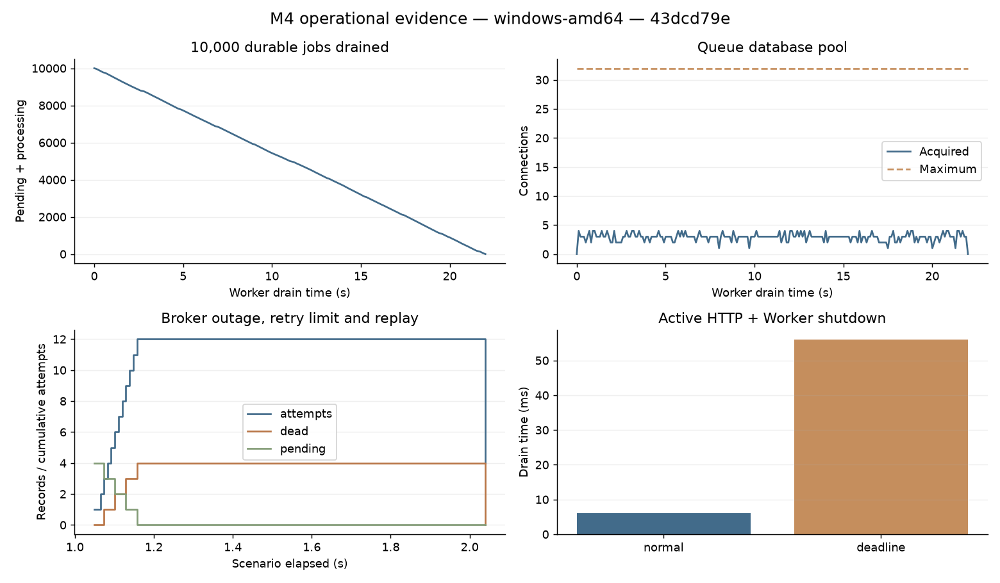
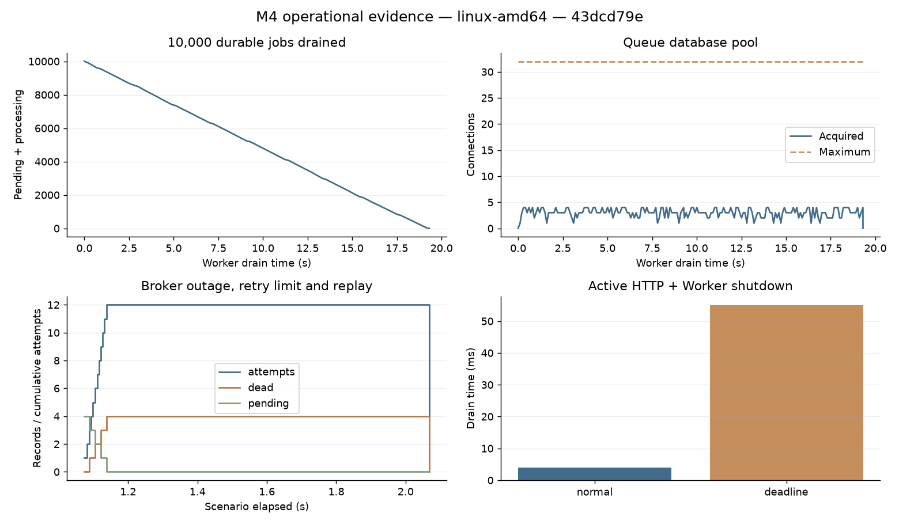

# M4 驗收紀錄

核對日期：2026-11-23。**M4 Verified**，來源 `43dcd79e24f5ed74a544a760301f4fec95dc2ca2`，分支 `codex/m4-platform-services`，規範基線 v1.3、產品版本 0.1.0。後續文件與證據 commit 不取代此 Runtime 來源。

`python scripts/m4.py gate --commit 43dcd79e24f5ed74a544a760301f4fec95dc2ca2` 已通過。同一乾淨 commit、同一 source bytes 的 Windows／固定 OCI Linux 均通過，Linux 包含完整真實整合 race。OPS-002、JOB-001、OBS-001 的 18 個具名情境，以及 M0–M3 累積回歸均通過。

## Exit 證據

| 工作包 | 已驗證行為 |
|---|---|
| WP14 Jobs／容量 | 版本 Registry、持久化 Scope／actor、同交易 enqueue、短交易 token claim、固定並行、兩 Worker barrier、期限／排程、取消、stale token、退避／dead、同交易 Audit replay、payload／owner 竄改隔離、外部穩定 Job ID 冪等 |
| WP14 恢復 | 真實 NATS 停止至重試上限、滿額拒絕接單、保留 dead、授權且稽核 replay、恢復後四筆原 ID／兩 Tenant 對帳，無遺失；Inbox 滿額不持久化新訊息，合法重複仍可確認 |
| WP14 Scope 回歸 | 當前 Tenant 服務 grant／代理使用者撤權拒絕；持久化 Organization Job 在替代 Provider 匯入後保留 owner／ID，替代 grant 撤銷後不執行副作用；原 A79／A91 契約累積回歸 |
| WP15 觀測 | HTTP→Use Case→SQL→UOW→Outbox→真實 NATS→Consumer 同 Trace 關聯、operation／event 識別、固定 cardinality Metrics、JSON redaction、Health 必要依賴與可選 Broker 邊界、積壓告警 |
| WP15 停機 | 活躍 HTTP＋Job 的正常與逾時 barrier 演練；先撤回 Ready／停認領，Handler 結束後才交還有效 lease，DB 最後關閉 |
| 工程與累積 Gate | build／vet／Unit／真實 Integration／分程序 API Worker E2E／Linux race／sqlc 再生成／109 個 module 的 checksum 與 license；缺案例、必跑 skip、缺 coverage profile 均拒絕 |

## Coverage 與固定負載

| Runner | 手寫 production statements | 64 producer／10,000 Job | enqueue p95／p99 | Broker 恢復至對帳 |
|---|---:|---:|---:|---:|
| windows-amd64 | 4024／4303（93.5162%） | 10000 筆全部排空 | 219.394／248.944 ms | 840 ms |
| linux-amd64 | 4023／4303（93.4929%） | 10000 筆全部排空 | 189.407／240.225 ms | 909 ms |

所有規範列出的關鍵 package 各自通過原始計數 90.00%；新增 Jobs、Jobs PostgreSQL 與 Observability 也各自超過 90%。只合併同 source／platform／build 的 Unit／Integration／分程序 E2E statement block 聯集，不平均百分比、不漏未測 package。

負載以固定 4 個 Worker 排空，保存 pool、pending、processing、heap、重試與 drain 資料。量測屬本機固定 fixture，不是生產容量 SLA 或備份還原 RPO；真實備份還原仍由後續發布演練處理。圖表從 Gate 已核對 hash 的原始資料產生。

## 來源及重現

Source SHA-256：`ceb979103e9e9ab1249d974d2c11aa2530590834967a9c1103f70a92f1d2eb41`。

| 證據 | SHA-256 |
|---|---|
| Windows report | `ee4cdc15aba6cbbedfde1d8a7f55c9c70f724d47f37713315c857eadca9cac80` |
| Linux report | `ad44c0cd4d2f71b6c8da344c88c83c0f672a0477f9116eef5db0bb531e7e8086` |
| 雙平台 Gate | `2102699c39ec04134567c004a37554e040c4486648efe7b668ddd153c2a61844` |

[機器可讀索引](m4-43dcd79e.json) 保存每個 package 原始計數、命令結果、兩平台的負載／恢復／drain 摘要。raw logs、profiles、HTML／JSON 與 operations／resilience／drain 曲線位於 `artifacts/43dcd79e24f5ed74a544a760301f4fec95dc2ca2/m4/`；重現見 [M4 開發指南](../guides/m4-development.md)與[運維手冊](../runbooks/operations.md)。遠端 CI 僅更新設定；本紀錄不宣稱遠端 CI 已執行。
